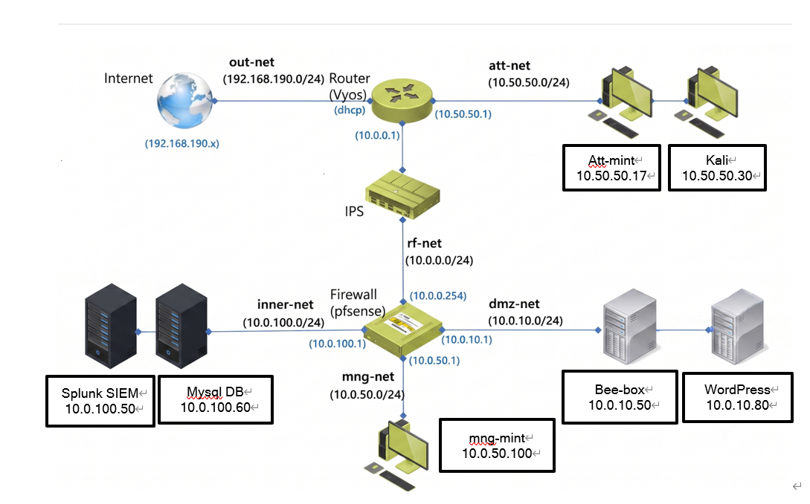
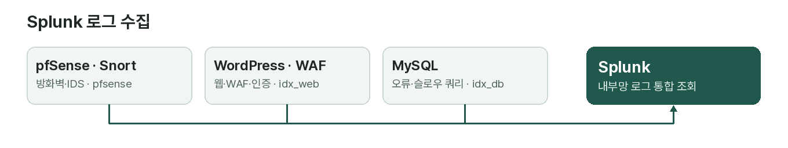

# SIEM 공격 탐지·대응 실습

## 환경 구축

**ESXi 기반 3-Tier** · 웹(Apache) → 애플리케이션(WordPress) → DB(MySQL)

- **보안 장비** · Firewall(pfSense) · IPS(Snort) · WAF(ModSecurity)

[환경 구축 과정](environment/README.md)

## 해킹 시나리오

| 시나리오 단계 | MITRE |
| --- | --- |
| 외부 정찰 | `T1595` |
| 공개 웹 서비스에 SQL 인젝션 시도 | `T1190` |
| 반복 로그인 시도 | `T1110` |
| 웹셸 접근과 실행 | `T1505.003` |
| 내부 정찰 | `T1046` |
| DB 정보 조회 | `T1213` |
| 외부 전송 시도 | `T1041` |

[공격 시나리오와 관측 근거](scenario/README.md)

## 디텍션

Splunk에서 반복 로그인과 웹셸 경보를 확인하고, 같은 시간대의 Snort·ModSecurity 기록을 대조했습니다.

[탐지 룰, 검증 결과와 Splunk 경보](detection/README.md)

## 대응 내역

1. **역추적** · 출발지 IP와 시각으로 Apache 요청과 WAF 로그를 연결했습니다. 웹 응답에서 DB 정보 노출 범위를 확인했습니다.
2. **차단** · pfSense에서 출발지를 차단하고, 같은 출발지에서 재접속해 타임아웃을 확인했습니다.
3. **후속 조치** · DB 감사 로그 수집과 DMZ에서 DB로 향하는 접근 제한을 재발 방지 방안으로 정리했습니다.

[사건 일지와 차단 결과](response/README.md)

## 최종 보고서

[PDF](report/siem-report.pdf) · [Word](report/siem-report.docx)
