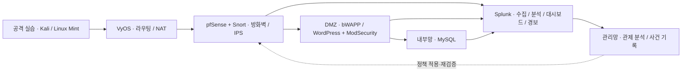

# SIEM 공격 탐지·대응 실습

**가상 기업망을 구축하고, 공격이 남긴 로그를 탐지 규칙·관제 화면·사건 보고서로 연결한 보안관제 프로젝트.**

ESXi 위에 웹·DB·관리망을 분리하고, pfSense·Snort·ModSecurity·Splunk로 관제 환경을 구성했습니다. 공격 시뮬레이션을 직접 수행하면서 **어떤 행위가 보이고 무엇을 놓치는지** 비교한 뒤, 다중 로그 분석과 차단 검증까지 기록했습니다.

[최종 보고서](phase4-soc/final-report.md) · [킬체인 분석](phase3-killchain/README.md) · [관제 일지](phase4-soc/incident-log.md) · [실습 진행 기록](DEVELOPMENT.md)

## 1. 목적과 핵심 질문

장비 설치나 경보 발생 확인을 넘어, **공격 수행 → 탐지·분석 → 대응 → 검증 → 보고**의 전체 흐름을 경험하는 것이 목표였습니다.

| 질문 | 확인한 방법 |
|---|---|
| 공격이 성공하면 IDS가 반드시 탐지할까? | 공격 실행 결과와 Snort 경보를 대조하고 미탐 원인을 분석 |
| 단일 장비가 놓치는 행위를 어떻게 보완할까? | 네트워크 경보와 Apache·WAF·MySQL 로그를 함께 조회 |
| 어떤 경보를 우선 대응해야 할까? | 정상 접속과 공격 패턴을 비교하고 사건별 판단 근거를 작성 |
| 차단 규칙을 넣었다는 사실만으로 대응이 끝날까? | 정책 적용 후 재접속·재스캔 결과로 실제 접근 차단 확인 |

모든 실험은 소유한 격리 가상망 안에서 수행했습니다. 아래 결과는 해당 시나리오와 수집 범위의 실습 기록입니다.

## 2. 무엇을 구축했나

| 계층 | 구성과 역할 | 산출물 |
|---|---|---|
| 가상 인프라 | ESXi, VyOS, pfSense로 공격망·DMZ·내부망·관리망 분리 | [구성 정보](DEVELOPMENT.md#인프라-현황) |
| 서비스·로그 | bWAPP, WordPress, MySQL, ModSecurity, rsyslog 기반 로그 수집 | [구축 문서·스크립트·설정](phase2.5-setup/) |
| 탐지 엔지니어링 | 커스텀 Snort 룰 9개, Splunk 상관분석 쿼리 7종 | [탐지 실험과 비교](phase3-killchain/README.md) |
| SOC 운영 | SOC_Monitor 대시보드, 5종 Alert, 경보 분류·차단 검증 | [관제 운영 기록](phase4-soc/README.md) |
| 분석·보고 | 사건 일지 INC-001~006, ATT&CK 매핑, 개선 권고 | [관제 일지](phase4-soc/incident-log.md), [최종 보고서](phase4-soc/final-report.md) |

## 3. 어떤 실험을 했고, 무엇을 확인했나

### 기초 공격과 탐지·차단 비교

bWAPP을 대상으로 정찰, SQL Injection, XSS, 명령 삽입, 경로 탐색, 인증 공격을 수행하고 실제 결과를 Snort/Splunk와 대조했습니다. 이후 공격자 IP 차단, DMZ 통신 제한, IPS 차단 모드를 적용했습니다.

저장형 XSS나 정상 로그인처럼 보이는 반복 요청 등에서는 경보가 충분하지 않았습니다. 요청 URI에 잘 드러나는 패턴과 POST body·애플리케이션 동작으로 이어지는 패턴의 관측 차이를 확인했습니다.

→ [공격 실행 기록](phase1-attack/README.md) · [탐지 분석과 방화벽 대응](phase2-detect/README.md)

### 웹 침해 시나리오와 탐지 엔지니어링

WordPress·MySQL 환경에서 정찰부터 인증 공격, 웹쉘 실행, 내부 정보 확인, DB 접근, 외부 전송 시도까지 이어지는 시나리오를 구성했습니다. SQLi 시도는 WordPress 코어에서 실패했으며, 실제 후속 경로는 관리자 인증 후 플러그인 편집을 통한 웹쉘 삽입이었습니다.

| 관찰 | 결과가 의미하는 것 |
|---|---|
| 커스텀 Snort 룰 9개 중 4개 SID에서 경보 확인 | 설계 시 가정한 직접 익스플로잇과 실제 관리자 인증·파일 편집 경로가 달라, 시그니처만으로 전체 행위를 포착하지 못함 |
| Apache·WAF·Snort 로그를 교차 조회 | 인증 시도와 웹쉘 요청을 네트워크 경보에만 의존하지 않고 분석 |
| DB 접근 전용 Alert 부재 | 웹쉘 요청 로그로 간접 관찰할 수 있어도 DB 쿼리의 정상·비정상 여부는 별도 감사 로그가 필요 |
| 외부 전송 시도에서 `Connection refused` | 전송 실패는 관찰했지만, 이 응답만으로 방화벽 차단을 단독 입증할 수는 없음 |

→ [킬체인 실행·상관분석·미탐 원인](phase3-killchain/README.md)

### SOC 시뮬레이션과 대응 검증

2026-08-27 관제 실습에서는 공격과 정상 접속을 구분하고, 경보를 사건으로 정리한 뒤 pfSense에 공격자 IP 차단 정책을 적용했습니다. 이후 **curl 타임아웃과 WPScan 중단**을 확인해 접근 차단 결과를 기록했습니다.

| 결과물·기록 | 확인한 내용 |
|---|---|
| Splunk Alert 5종 | 브루트포스·스캐너·SQLi·웹쉘·WAF 급증 조건 정의 |
| 해당 관제 회차의 Alert 트리거 7건 | 설정한 Alert 종류 수와 실제 발생 횟수를 구분 |
| 7단계 시나리오의 탐지 범위 | 보고서 분류상 5단계 완전 탐지, DB 접근 1단계 부분 탐지. 외부 전송 단계는 실패 기록이며 차단 원인 확정에는 추가 근거 필요 |
| 사건 일지 6건 | 탐지 출처·판별 근거·위험도·대응·검증을 사건별로 기록 |
| 최종 보고서 | 경영진 요약, 공격·탐지·대응 분석, IOC, 쿼리, 개선 권고 정리 |

이 수치는 정해진 랩 시나리오의 결과이며 일반적인 탐지 정확도나 제품 성능 지표는 아닙니다. 스캐너 Alert는 실행 주기와 공격 시각이 맞지 않아 트리거를 놓쳤고, WAF 로그는 전용 `idx_waf` 대신 `idx_web`에서 조회했습니다.

→ [SOC 실행 기록](phase4-soc/README.md) · [최종 보고서](phase4-soc/final-report.md)

## 4. 실습에서 배운 점

### 공격 도구 이름보다 실제 경로를 봐야 한다

같은 웹쉘 삽입이라도 취약 엔드포인트 직접 호출과 관리자 인증 후 플러그인 편집은 서로 다른 흔적을 남겼습니다. 룰을 추가하는 것만으로 충분하지 않았고, **실제로 지나간 경로와 센서가 볼 수 있는 범위**를 먼저 확인해야 했습니다.

### 경보 수와 공격 성공 여부는 다르다

실패한 SQLi도 경보를 만들었고, DB 접근은 전용 경보 없이 진행됐습니다. 경보는 조사 시작점이며, 성공 여부와 영향은 응답·서비스 상태·여러 로그를 함께 보고 판단해야 한다는 점을 배웠습니다.

### SIEM의 가치는 로그를 함께 해석하는 데 있다

Snort만으로 부족한 인증·웹쉘 행위를 Apache와 ModSecurity 로그로 보완했습니다. 반대로 MySQL error/slow 로그만으로는 쿼리 의도를 충분히 설명하기 어려웠습니다. 탐지 쿼리 이전에 **무슨 로그가 수집되고, 어떤 정보가 빠져 있는지** 알아야 했습니다.

### 대응에는 검증과 기록이 따라야 한다

방화벽 정책 적용 후 재접속·재스캔을 수행하고, 판단 근거와 결과를 사건 일지에 남겼습니다. 전송 실패와 정책 효과의 인과관계를 구분하는 것도 대응 검증의 일부입니다.

## 5. 한계와 다음 아이디어

| 남은 과제 | 이번 실습에서 얻은 개선 방향 |
|---|---|
| DB 접근의 부분 가시성 | MySQL 감사 로그를 수집하고 정상 쿼리와 비교할 기준 마련 |
| 경보 스케줄의 사각지대 | 검색 주기·시간 범위·임계값을 짧은 공격과 정상 트래픽으로 재검증 |
| WAF 로그 혼합 수집, DetectionOnly 운영 | 전용 인덱스 분리와 차단 모드 전환 전 정상 요청 영향 확인 |
| 네트워크·웹 로그 중심 조사 | EDR 프로세스 트리·파일 변경·포렌식 증거와 연결 |
| 수동 사건 처리 | IOC·관제 기록을 구조화하고 승인 가능한 대응 자동화로 확장 |

EDR·AI 관제·자동 대응은 확장 아이디어이며 이번 실습의 완성 기능으로 포함하지 않습니다. 상세 논의는 [최종 보고서의 사고 확장](phase4-soc/final-report.md)과 [확장 방향 메모](프로젝트-확장방향.md)에 있습니다.

## 6. 결과물 찾아보기

| 문서·디렉터리 | 내용 |
|---|---|
| [phase4-soc/final-report.md](phase4-soc/final-report.md) | 프로젝트 결과를 한 번에 읽는 최종 보고서 |
| [phase4-soc/incident-log.md](phase4-soc/incident-log.md) | INC-001~006 사건별 분석·대응 기록 |
| [phase1-attack/](phase1-attack/) | 기초 공격 실행·출력·탐지 증적 |
| [phase2-detect/](phase2-detect/) | Splunk 분석·방화벽 정책·IPS 대응 |
| [phase2.5-setup/](phase2.5-setup/) | 구축 스크립트·설정·SQL·로그 수집 구성 |
| [phase3-killchain/](phase3-killchain/) | 킬체인·커스텀 룰·상관분석·미탐 원인 |
| [phase4-soc/](phase4-soc/) | 대시보드·Alert·관제 실습·화면 증적 |
| [공격유형-사전조사.md](공격유형-사전조사.md) | 공격 원리·탐지·방어 사전 조사 |
| [컨설팅-취약점진단.md](컨설팅-취약점진단.md) | 위험 평가와 개선 권고 |
| [DEVELOPMENT.md](DEVELOPMENT.md) | 원래 진행 체크리스트·IP 구성·잔여 작업 |

저장소는 실습 기록·설정·스크립트를 제공하며 ESXi VM 이미지나 즉시 실행되는 통합 환경은 포함하지 않습니다. 재현 시에는 [환경 구축 문서](phase2.5-setup/README.md)와 [진행·환경 기록](DEVELOPMENT.md)을 함께 확인하세요.
