# 디텍션

Snort는 망 경계에서, ModSecurity는 웹 서버에서 관측했습니다. Splunk에서 같은 시각대의 출발지와 웹 요청을 대조해 경보의 영향 범위를 확인했습니다.

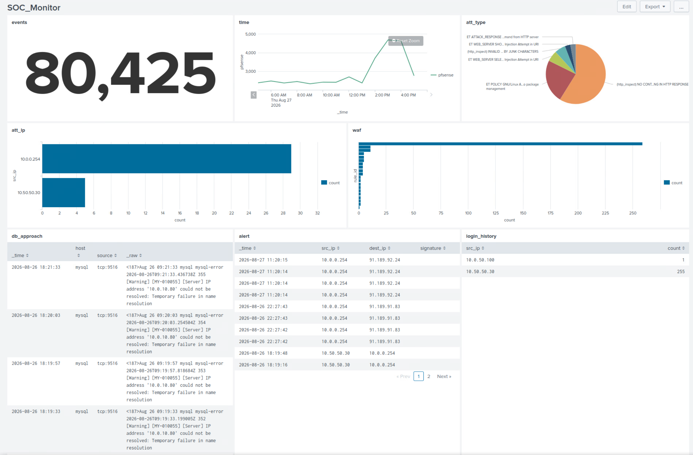

| 항목 | 확인한 결과 |
| --- | --- |
| Snort | 실습 기록에서 커스텀 SID 4개의 경보 확인 |
| Splunk | 저장 경보 5종 중 4종이 발생. WAF 반복 경보와 19:45 웹셸 경보를 포함해 총 8건 |
| 관제 화면 | 전체 이벤트, 출발지별 경보, WAF, 인증, DB 기록을 한 화면에서 비교 |
| 탐지 범위 | 7단계 중 5단계 공격 시도 탐지, DB 접근 1단계 부분 탐지, 외부 전송 실패 1단계 |

정찰은 Snort와 웹 로그에서 확인했습니다. 관제 일지에 기록된 Splunk 경보 8건에는 Scanner Detection이 없습니다. SQL 인젝션은 요청 경보와 응답을 따로 확인했습니다.

## pfSense 커스텀 룰

pfSense WAN에 적용한 룰과 초기 설계 문서의 SID 배정이 달랐습니다. 경보를 분석할 때는 실제 설정의 SID를 기준으로 삼았습니다.

| pfSense SID | 룰 | 설계 파일의 SID |
| --- | --- | --- |
| `1000001` | WPScan 정찰 | `1000009` |
| `1000002` | 반복 로그인 요청 | `1000001` |
| `1000004` | SQL Injection 시도 | 해당 룰 없음 |
| `1000006` | 웹셸 접근 시도 | `1000007`에 웹셸 응답을 보는 별도 룰 정의 |

`1000006`은 복구한 설정과 8월 27일 원본 경보 양쪽에서 확인했습니다. 위 표는 현재 룰 정의를 기준으로 작성했으며, 당시 경보 발생 여부는 로그에서 별도로 확인했습니다.

### pfSense WAN 룰 원문

```text
# WordPress 정찰
alert tcp $EXTERNAL_NET any -> $HOME_NET $HTTP_PORTS (msg:"LOCAL WordPress wpscan detected"; flow:to_server,established; content:"WPScan"; http_header; sid:1000001; rev:1;)

# wp-login 브루트포스
alert tcp $EXTERNAL_NET any -> $HOME_NET $HTTP_PORTS (msg:"LOCAL WordPress login brute-force attempt"; flow:to_server,established; content:"POST"; http_method; content:"/wp-login.php"; http_uri; detection_filter:track by_src,count 5,seconds 60; sid:1000002; rev:1;)

# xmlrpc 브루트포스
alert tcp $EXTERNAL_NET any -> $HOME_NET $HTTP_PORTS (msg:"LOCAL WordPress xmlrpc brute-force"; flow:to_server,established; content:"POST"; http_method; content:"/xmlrpc.php"; http_uri; content:"methodCall"; http_client_body; sid:1000003; rev:1;)

# SQL Injection
alert tcp $EXTERNAL_NET any -> $HOME_NET $HTTP_PORTS (msg:"LOCAL SQL Injection attempt UNION SELECT"; flow:to_server,established; content:"UNION"; nocase; http_uri; content:"SELECT"; nocase; http_uri; sid:1000004; rev:1;)

# File Manager CVE-2020-25213
alert tcp $EXTERNAL_NET any -> $HOME_NET $HTTP_PORTS (msg:"LOCAL WP File Manager CVE-2020-25213 exploit"; flow:to_server,established; content:"POST"; http_method; content:"connector.minimal.php"; http_uri; sid:1000005; rev:1;)

# 웹쉘 접근
alert tcp $EXTERNAL_NET any -> $HOME_NET $HTTP_PORTS (msg:"LOCAL Webshell access attempt"; flow:to_server,established; content:".php"; http_uri; content:"cmd"; http_uri; sid:1000006; rev:1;)

# 내부 네트워크 스캔 (DMZ→inner)
alert tcp 10.0.10.0/24 any -> 10.0.100.0/24 any (msg:"LOCAL DMZ to Internal network scan"; flags:S; threshold:type threshold,track by_src,count 5,seconds 60; sid:1000007; rev:1;)

# DB 대량 조회 (큰 응답)
alert tcp 10.0.100.0/24 3306 -> 10.0.10.0/24 any (msg:"LOCAL Large MySQL response to DMZ"; flow:from_server,established; dsize:>10000; sid:1000008; rev:1;)

# 외부 유출 시도 (DMZ→외부)
alert tcp 10.0.10.0/24 any -> $EXTERNAL_NET any (msg:"LOCAL DMZ outbound data exfiltration attempt"; flow:to_server,established; dsize:>5000; sid:1000009; rev:1;)
```

## 탐지 검증

### Snort에서 경보를 확인한 룰

pfSense에 들어 있는 SID와 Splunk가 수집한 시그니처 메시지를 대조했습니다. 아래는 커스텀 룰 검증 회차의 경보 수입니다.

| SID | 탐지 대상 | 경보 수 |
| --- | --- | --- |
| `1000001` | WordPress 정찰 | 1,973 |
| `1000002` | 반복 로그인 요청 | 8 |
| `1000004` | SQL 인젝션 시도 | 3 |
| `1000006` | 웹셸 접근 시도 | 17 |
| `1000003`, `1000005`, `1000007`~`1000009` | 설정 파일에 정의된 나머지 룰 | 0 |

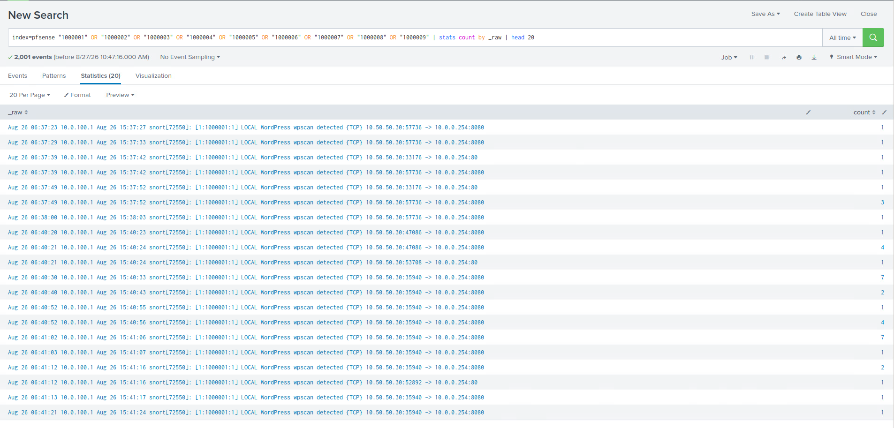

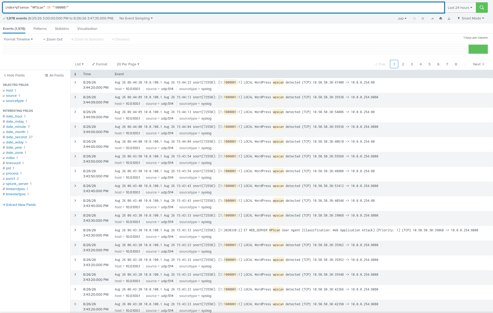

SQL 인젝션에서는 커스텀 룰 3건과 ET 룰 18건이 기록됐습니다. 센서가 요청에 반응한 횟수이므로 침해 성공 건수로 해석하지 않았습니다.

### 센서별 집계 대조

#### 반복 로그인

Apache에서 로그인 페이지 접근 317건을 확인했고, Snort에서는 반복 요청 임계값을 넘긴 경보 8건을 확인했습니다. 317건은 페이지 접근 수이고 8건은 룰이 발생시킨 경보 수입니다. 최종 관제 일지의 965건은 별도 회차에서 집계한 Apache 로그인 요청입니다.

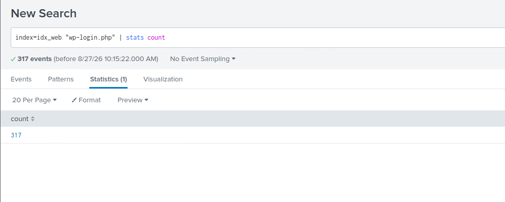

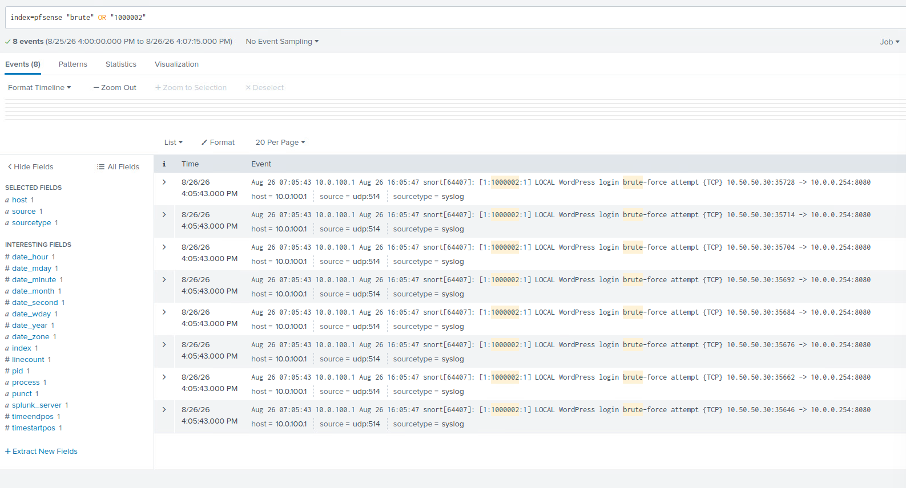

#### DB 접근

`idx_db`에서 MySQL 기록 347건이 `syslog` sourcetype으로 들어온 것을 확인했습니다. 이 숫자는 오류 로그 이벤트입니다. 특정 DB 조회나 노출 건수는 웹 응답을 근거로 따로 판단했습니다.

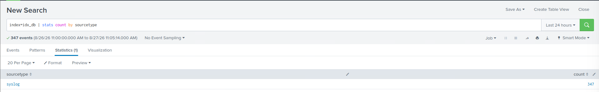

#### 정탐과 정상 접속

정찰은 웹 요청의 User-Agent와 Snort 경보를, 반복 로그인은 짧은 시간에 몰린 요청과 출발지를 함께 확인했습니다. 관리 단말의 정상 로그인은 비교용으로 따로 기록했습니다. 비교군 한 건으로 전체 오탐률을 계산하지 않았습니다.

### Splunk 모니터링

대시보드에는 경보 시그니처, 출발지, 인증 요청, WAF, DB 로그를 함께 배치했습니다. 아래 화면은 브루트포스 저장 검색의 5분 실행 주기 설정입니다.

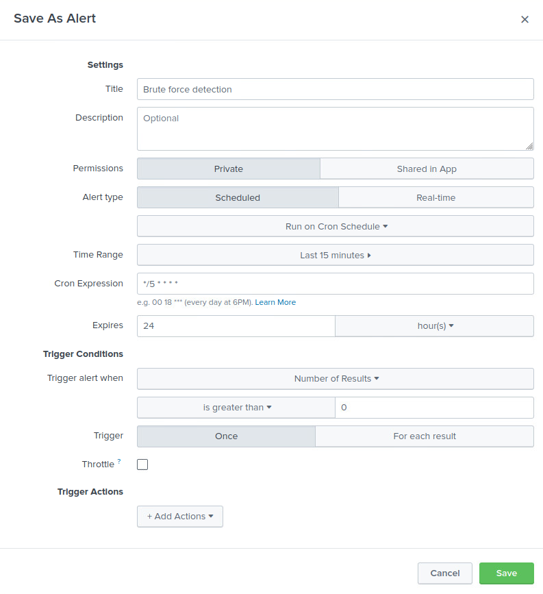

## Splunk 검색과 경보

실습 때 작성한 SPL을 주제별로 보관했습니다. 당시 관제 일지와 캡처에는 저장 경보 5종 중 4종이 발생한 기록이 있습니다. 아래 SPL 파일의 검색 결과는 쿼리별로 확인 범위를 따로 적었습니다.

| SPL | 무엇을 확인하는지 | 확인 상태 |
| --- | --- | --- |
| 1. 로그인 요청과 Snort 경보 | 같은 출발지의 웹 요청과 경보를 대조 | Phase 3 기록에 Apache 317건, Snort 8건 |
| 2. SQL 인젝션 관련 경보 집계 | 경보 소스별 관측 수 비교 | Phase 3 기록에 ET 룰 18건, 커스텀 SID 3건 |
| 3. 웹 요청 시퀀스 | 관련 웹 요청을 집계 | Phase 3 기록에 웹 요청 37건 |
| 4. Snort 시간축 · 다중 소스 시간축 | 로그를 시간대별로 묶어 사건 흐름 확인 | Phase 3 기록에 Snort 시간축 확인. 다중 소스 버전은 별도 검증 필요 |
| 5. DB 활동 조회 · 건수 조회 | DB 기록에 남은 활동과 건수 조회 | 기존 쿼리의 sourcetype과 실제 DB 로그의 syslog가 달랐음 |
| 6. 반복 로그인 요청 경보 | 웹 요청을 출발지별로 집계 | 해당 유형 경보 발생 기록 있음 |
| 7. 출발지별 위험 점수 | 여러 종류의 Snort 경보를 점수로 집계 | 기존 쿼리는 pfSense 센서 호스트로 묶음. 출발지별 검증 미완료 |

6번은 웹 로그를 쓰는 단일 소스 경보입니다. 로그인 요청에 대한 경보는 확인했으며, 실제 침해 여부를 판단할 때는 응답과 다른 로그를 함께 봤습니다. 관리 단말의 정상 접속 1건과 실습 요청을 구분한 기록이 있습니다.

### SPL 원문

#### 1. 로그인 요청과 Snort 경보

```spl
index=idx_web "wp-login.php"
| eval source="Apache"
| append [search index=pfsense "1000002" | eval source="Snort"]
| stats count by source
```

#### 2. SQL 인젝션 관련 경보 집계

```spl
index=pfsense ("SQL" OR "1000004")
| eval layer=case(
    like(_raw,"%1000004%"), "Snort/커스텀",
    like(_raw,"%ET WEB_SERVER%"), "Snort/ET",
    true(), "Snort/기타")
| stats count by layer
```

#### 3. 웹 요청 시퀀스

```spl
index=idx_web "cmd="
| stats count by source
```

#### 4. Snort 시간축

```spl
index=pfsense ("1000001" OR "1000002" OR "1000004" OR "1000006")
| eval phase=case(
    like(_raw,"%1000001%"),"1_WPScan",
    like(_raw,"%1000002%"),"2_BruteForce",
    like(_raw,"%1000004%"),"3_SQLi",
    like(_raw,"%1000006%"),"4_Webshell")
| timechart span=5m count by phase
```

#### 다중 소스 시간축

```spl
index=pfsense ("1000002" OR "1000004" OR "1000006")
| eval phase=case(
    like(_raw,"%1000002%"),"3_BruteForce",
    like(_raw,"%1000004%"),"2_SQLi",
    like(_raw,"%1000006%"),"4_Webshell")
| append [search index=idx_web "cmd=" | eval phase="5_InternalRecon"]
| append [search index=idx_db | eval phase="6_DB_Access"]
| append [search index=pfsense "10.0.10.80" "10.50.50.30" "filterlog" | eval phase="7_Exfil_Attempt"]
| timechart span=5m count by phase
```

#### 5. DB 활동 조회

```spl
index=idx_db (sourcetype="mysql:slow" OR sourcetype="mysql:error")
| eval is_external=if(match(host,"10\.0\.10\."), "DMZ(비정상)", "정상")
| stats count by host, is_external, user
| where is_external="DMZ(비정상)"
```

#### 건수 조회

```spl
index=idx_db host=mysql
```

#### 6. 반복 로그인 요청 경보

```spl
index=idx_web sourcetype="apache:access" uri="/wp-login.php" method="POST"
| bucket _time span=1m
| stats count by _time, clientip
| where count >= 5
```

#### 7. 출발지별 위험 점수

```spl
index=pfsense ("1000001" OR "1000002" OR "1000004" OR "1000006")
| eval score=case(
    like(_raw,"%1000001%"), 1,
    like(_raw,"%1000002%"), 3,
    like(_raw,"%1000004%"), 5,
    like(_raw,"%1000006%"), 8)
| eval phase=case(
    like(_raw,"%1000001%"), "WPScan",
    like(_raw,"%1000002%"), "BruteForce",
    like(_raw,"%1000004%"), "SQLi",
    like(_raw,"%1000006%"), "Webshell")
| stats sum(score) as risk_score, count as event_count, values(phase) as attack_phases by host
| sort -risk_score
```

## ATT&CK 매핑과 관측 지표

최종 WordPress·MySQL 관제 실습의 단계와 당시 판단에 사용한 로그입니다. 각 항목의 확인 범위는 실습 기록을 따릅니다.

| 실습 단계 | ATT&CK | 확인 범위 |
| --- | --- | --- |
| 정찰 | T1595 Active Scanning | Snort 경보와 웹 요청에서 정찰 관련 기록 확인 |
| 외부 공개 서비스 공격 시도 | T1190 Exploit Public-Facing Application | Snort와 WAF에서 요청 시도 확인 |
| 반복 로그인 | T1110 Brute Force | Apache 요청과 Splunk 경보 확인 |
| 웹셸 | T1505.003 Web Shell | 웹 요청과 서버 응답 대조 |
| 내부 조사 | T1046 Network Service Discovery | 기존 시나리오 매핑. 내부 정보 조회 흔적은 확인했고 네트워크 서비스 스캔은 미확정 |
| DB 접근 | T1213 Data from Information Repositories | 웹 응답에서 정보 노출 확인. DB 로그의 가시성은 일부에 한정 |
| 외부 전송 시도 | T1041 Exfiltration Over C2 Channel | 기존 시나리오 매핑. 전송 실패 확인, 명령제어 채널과 외부 수신은 미확정 |

### 관측 지표

- 최종 회차 실습 출발지. `10.50.50.30`이 Snort와 웹 로그에 기록됐습니다.
- 웹 요청의 User-Agent. `WPScan`과 `Hydra`가 남아 있었습니다. 같은 시각대의 요청량과 출발지를 함께 대조했습니다.
- 웹셸 관련 요청. 웹 기록과 실행 결과가 포함된 응답을 함께 확인했습니다.

## Bee-box 탐지·차단 검증

초기 Bee-box 환경에서 Snort 경보를 Splunk로 가져오고, 출발지와 시각으로 실습 요청을 확인한 뒤 pfSense와 Snort의 차단 정책을 단계별로 적용했습니다.

### Splunk 분석 준비

pfSense에서 전송한 syslog를 `pfsense` 인덱스로 받았습니다. Snort 경보에 필요한 출발지·목적지·목적지 포트와 시그니처를 원본 메시지에서 추출했습니다. 처음에는 필드가 자동으로 잡히지 않아, 필드 추출 결과와 이벤트 시각부터 확인했습니다.

원본 syslog를 바로 대조할 때 사용한 필드 추출 검색입니다. 시간대가 다른 센서를 비교하기 전에 Splunk가 표시하는 시각을 확인했습니다.

```spl
index=pfsense snort
| rex "(?P<src>\d+\.\d+\.\d+\.\d+):\d+\s+->\s+(?P<dest>\d+\.\d+\.\d+\.\d+):(?P<dest_port>\d+)"
| rex "snort\[\d+\]:\s+\[\S+\]\s+(?P<signature>[^\[]+)\s+\["
| table _time src dest dest_port signature
```

### Snort 경보 확인

pfSense의 Snort Alerts에서 경보의 시각·출발지·목적지·시그니처를 확인한 뒤 Splunk에서 같은 이벤트를 찾았습니다.

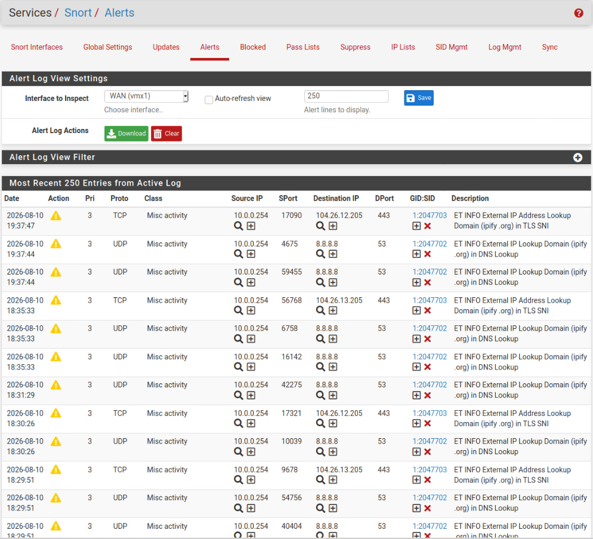

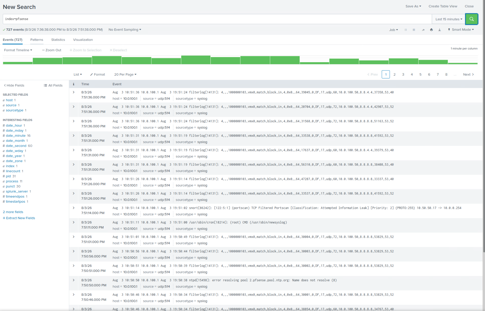

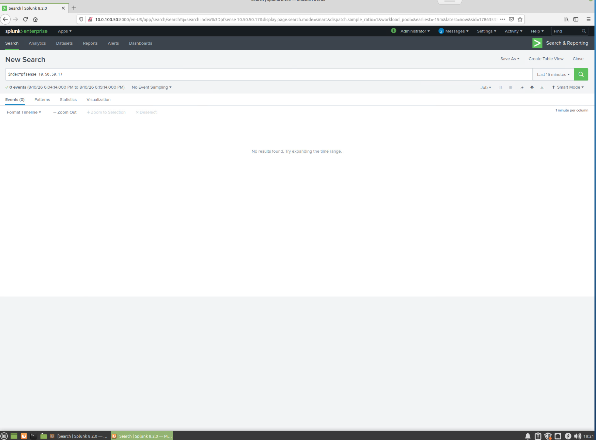

### 출발지와 시간대 분석

Splunk에서 Snort 경보를 출발지별로 집계하고, 요청이 집중된 시간대와 시그니처의 분포를 대조했습니다. 이 회차의 경보는 **1,170건**이며, 주된 실습 단말의 출발지 `10.50.50.17`에서 **1,142건**이 기록됐습니다. 수치는 이 Bee-box 환경에서 센 Snort 경보입니다.

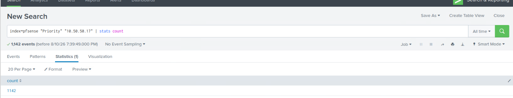

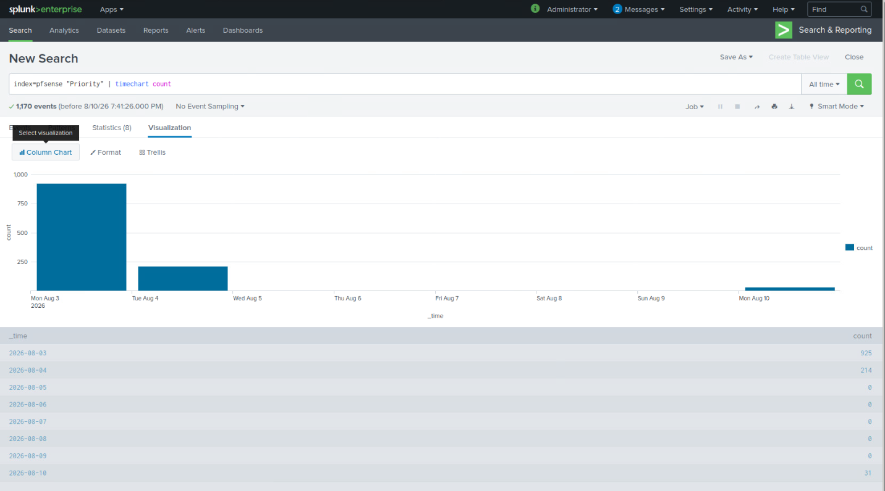

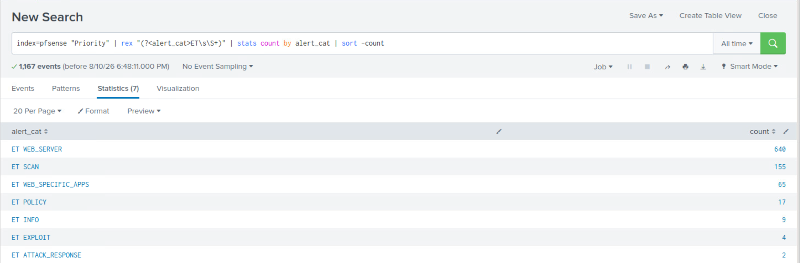

당시 Snort는 WAN에서 관찰했습니다. 경보의 목적지에는 Bee-box 내부 주소 대신 pfSense의 WAN 주소가 표시됐습니다. 목적지가 왜 다르게 보이는지 네트워크 배치와 비교했습니다.

출발지, 시그니처, 시간대별 분포를 비교할 때 사용한 검색입니다.

```spl
index=pfsense | stats count by src | sort -count | head 10
```

```spl
index=pfsense 10.50.50.17 snort | top 10 signature
```

```spl
index=pfsense 10.50.50.17 snort | timechart span=5m count by signature
```

### 방어 정책별 확인

| 적용한 정책 | 확보한 근거 |
| --- | --- |
| 출발지 기준 WAN 차단 | 같은 단말에서 연결을 다시 확인했습니다. 아래 캡처는 ICMP 요청이 닿지 않은 결과입니다. |
| DMZ 통신 제한 | DMZ에서 내부망으로 향하는 통신과 필요한 웹 서비스 범위를 방화벽 규칙에서 나눴습니다. |
| Snort 차단 모드 | Snort의 차단 호스트 목록에 실습 출발지가 올라온 것을 확인했습니다. |

먼저 차단 전 WAN 정책과 실습 요청을 확인한 뒤 출발지 차단을 적용했습니다. Snort의 자동 차단은 출발지 차단 정책과 구분해 확인했습니다. DMZ 통신 제한은 마지막에 적용해 웹 서비스에 필요한 통신 범위를 확인했습니다.

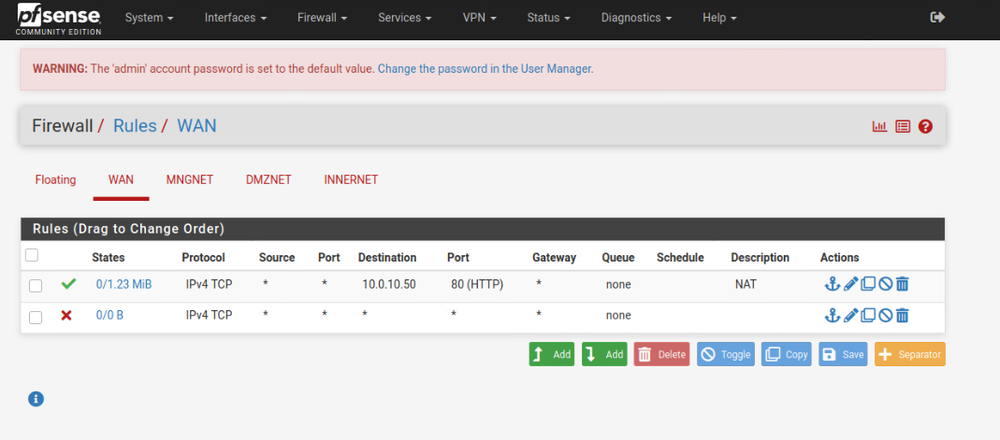

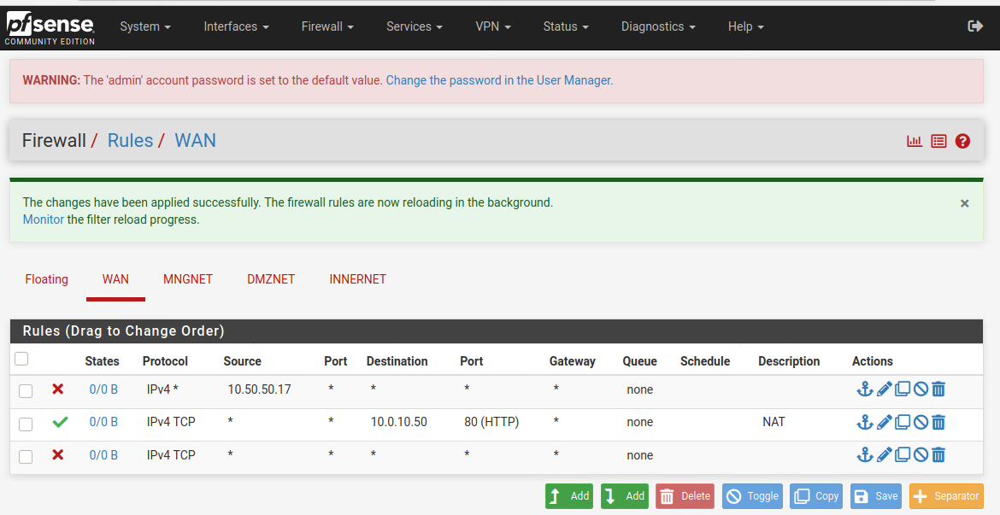

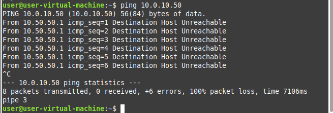

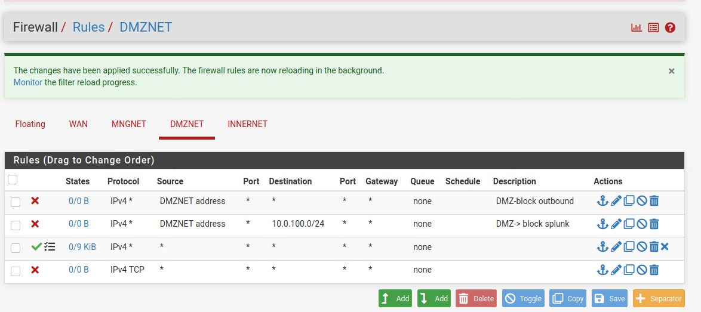

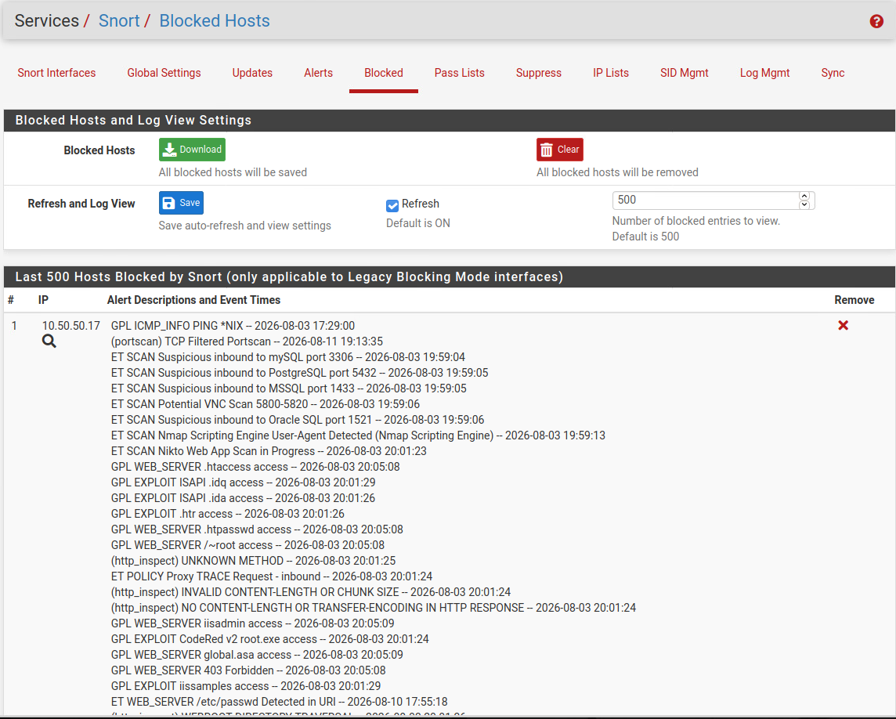
