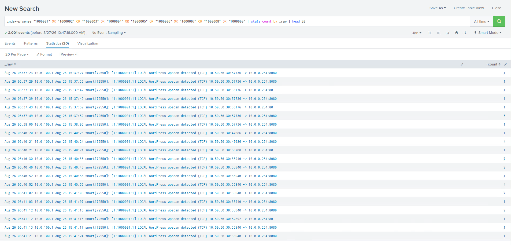
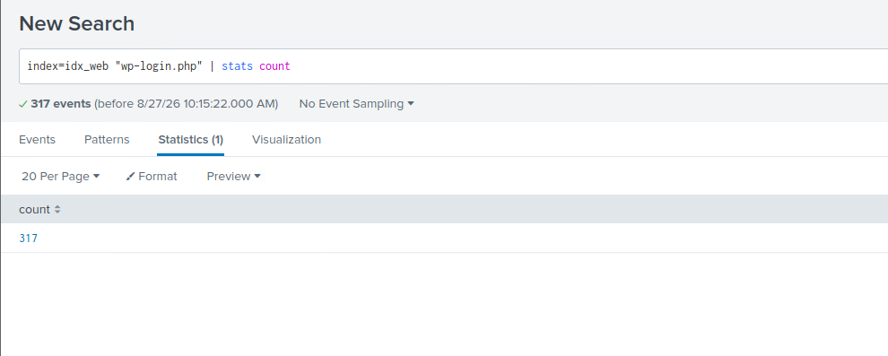
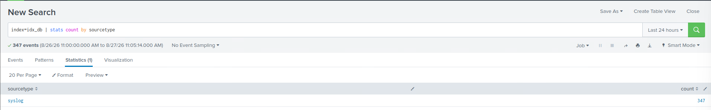
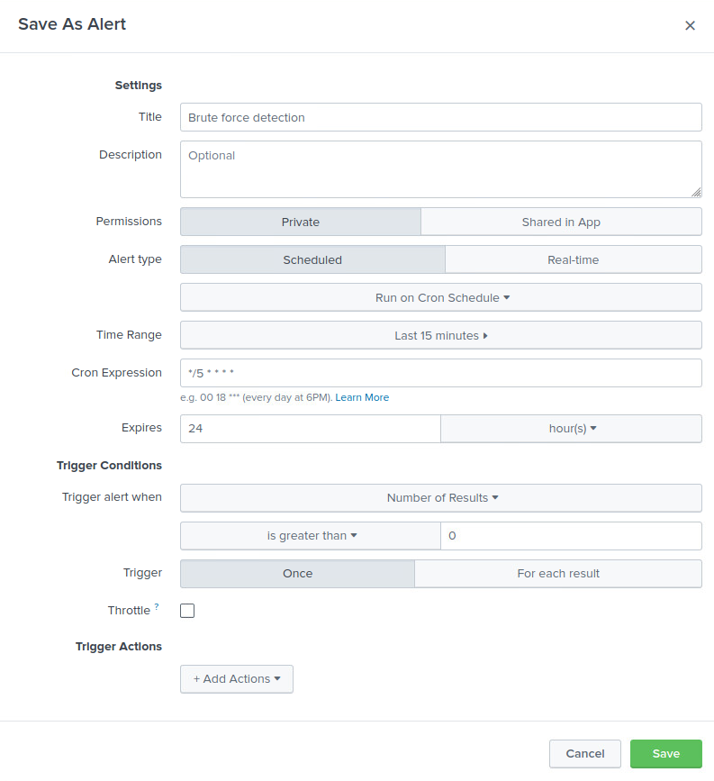

# 탐지 검증

## Snort에서 경보를 확인한 룰

pfSense에 들어 있는 SID와 Splunk가 수집한 시그니처 메시지를 대조했습니다. 아래는 커스텀 룰 검증 회차의 경보 수입니다.

| SID | 탐지 대상 | 경보 수 |
| --- | --- | --- |
| `1000001` | WordPress 정찰 | 1,973 |
| `1000002` | 반복 로그인 요청 | 8 |
| `1000004` | SQL 인젝션 시도 | 3 |
| `1000006` | 웹셸 접근 시도 | 17 |
| `1000003`, `1000005`, `1000007`~`1000009` | 설정 파일에 정의된 나머지 룰 | 0 |

SQL 인젝션에서는 커스텀 룰 3건과 ET 룰 18건이 기록됐습니다. 센서가 요청에 반응한 횟수이므로 침해 성공 건수로 해석하지 않았습니다.

## 센서별 집계 대조

### 반복 로그인

Apache에서 로그인 페이지 접근 317건을 확인했고, Snort에서는 반복 요청 임계값을 넘긴 경보 8건을 확인했습니다. 317건은 페이지 접근 수이고 8건은 룰이 발생시킨 경보 수입니다. 최종 관제 일지의 965건은 별도 회차에서 집계한 Apache 로그인 요청입니다.

### DB 접근

`idx_db`에서 MySQL 기록 347건이 `syslog` sourcetype으로 들어온 것을 확인했습니다. 이 숫자는 오류 로그 이벤트입니다. 특정 DB 조회나 노출 건수는 웹 응답을 근거로 따로 판단했습니다.

### 정탐과 정상 접속

정찰은 웹 요청의 User-Agent와 Snort 경보를, 반복 로그인은 짧은 시간에 몰린 요청과 출발지를 함께 확인했습니다. 관리 단말의 정상 로그인은 비교용으로 따로 기록했습니다. 비교군 한 건으로 전체 오탐률을 계산하지 않았습니다.

## Splunk 모니터링

대시보드에는 경보 시그니처, 출발지, 인증 요청, WAF, DB 로그를 함께 배치했습니다. 아래 화면은 브루트포스 저장 검색의 5분 실행 주기 설정입니다.

[검색과 경보 정의](README.md#splunk-검색과-경보) · [실제 발생한 경보와 대응](../response/README.md#splunk-경보)
