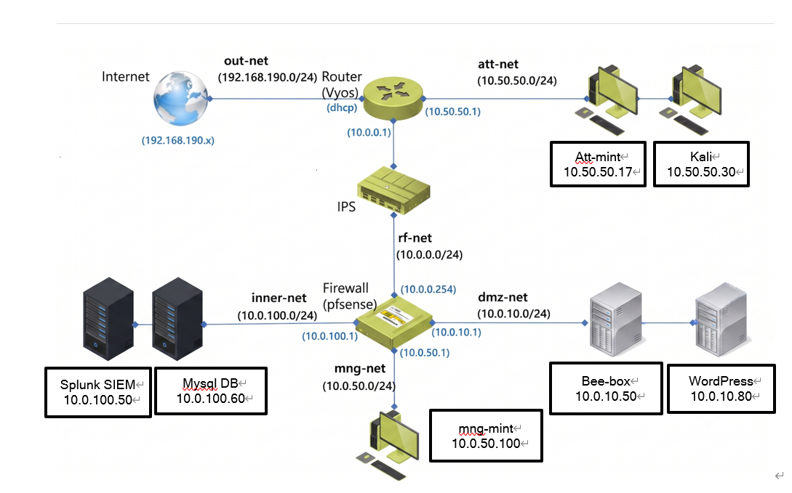
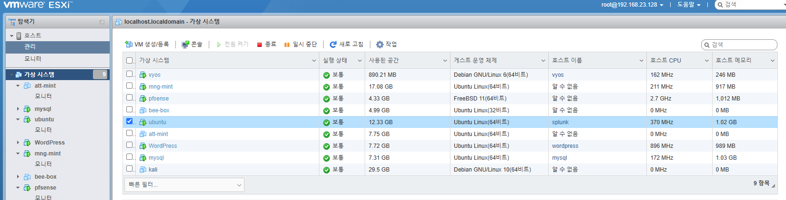
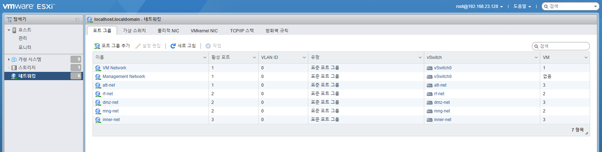
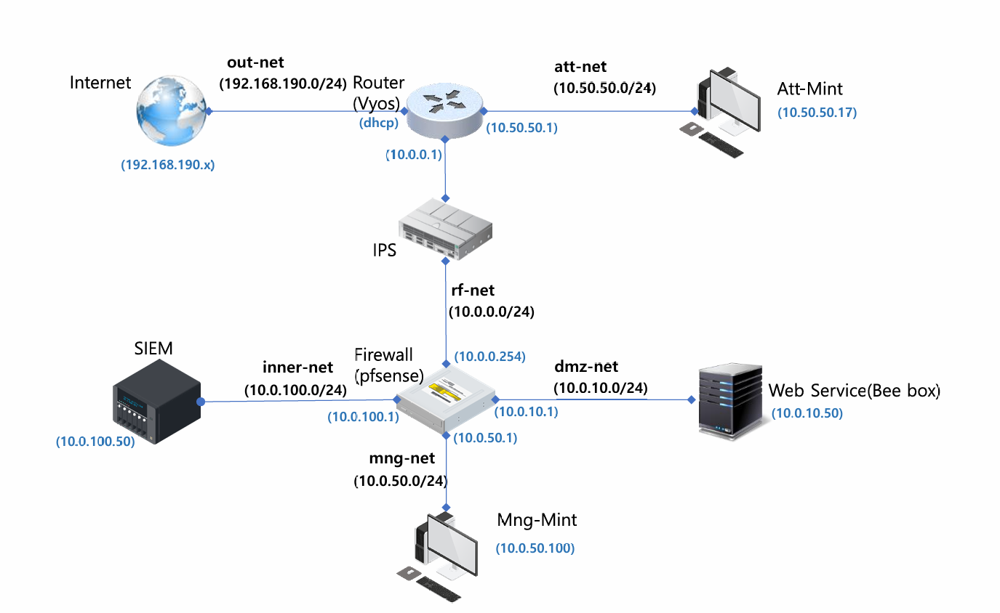

# 네트워크 구성

ESXi에서 실습망, 외부 경계망, DMZ, 내부망, 관리망을 나눴습니다. VyOS는 라우팅을 맡고, pfSense와 Snort는 망 경계에서 통신과 경보를 기록합니다.

## 최종 실습망

복구한 ESXi에는 VM 9대가 등록돼 있습니다. VM 목록에서 `ubuntu`의 호스트 이름이 `splunk`로 표시됩니다. ESXi 관리용 `Management Network`는 `vSwitch0`에 있고, 실습 관리 단말의 `mng-net`은 별도 vSwitch에 연결됩니다.

### 가상 스위치와 VM 배치

실습용 포트 그룹 다섯 개를 같은 이름의 가상 스위치에 연결했습니다. 복구한 ESXi의 포트 그룹 화면에서 다섯 그룹 모두 VLAN ID 0으로 표시됩니다.

| 포트 그룹 | 연결된 장비 | 역할 |
| --- | --- | --- |
| `att-net` | VyOS, att-mint, Kali | 실습 단말이 연결된 외부 구간 |
| `rf-net` | VyOS, pfSense | 라우터에서 방화벽 WAN으로 이어지는 구간 |
| `dmz-net` | pfSense, Bee-box, WordPress | 웹 서비스 구간. WordPress에서 Apache와 ModSecurity 로그를 수집 |
| `inner-net` | pfSense, Splunk, MySQL | DB 서비스와 로그 수집 서버를 배치한 내부망 |
| `mng-net` | pfSense, mng-mint | 관제 화면을 확인하고 정상 접속을 비교한 관리망 |

## 초기 Bee-box 환경

Bee-box에서 탐지와 차단을 먼저 확인했습니다. [Bee-box 탐지와 차단 검증](bee-box/README.md)에 Splunk 분석 준비, Snort 경보 확인, 로그 분석과 방화벽 정책별 기록을 남겼습니다.

## 로그를 확인한 위치

| 구역 | 구성 | 관측 내용 |
| --- | --- | --- |
| 실습망 | att-mint, Kali | 실습에서 발생시킨 접근 |
| 경계망 | VyOS, pfSense, Snort | 라우팅, 방화벽 정책, 네트워크 경보 |
| DMZ | Bee-box, WordPress, Apache, ModSecurity | 웹 요청·오류, WAF 경보, 인증 시도 |
| 내부망 | MySQL, Splunk | DB 오류·느린 쿼리, 로그 통합 조회 |
| 관리망 | 관리 단말 | 정상 요청 비교와 관제 작업 |

| 로그 소스 | 전송 경로 | Splunk 인덱스 |
| --- | --- | --- |
| pfSense filterlog, Snort 경보 | pfSense syslog, UDP 514 | `pfsense` |
| Apache 접근·오류, ModSecurity, WordPress 인증 | 웹 서버 rsyslog, TCP 9514 | `idx_web` |
| MySQL 오류·슬로우 쿼리 | DB 서버 rsyslog, TCP 9516 | `idx_db` |

WAF용 `idx_waf`도 설정했습니다. 관제에 사용한 ModSecurity 기록은 `idx_web`에서 확인했습니다.

[최종 보고서](../../report/README.md)
