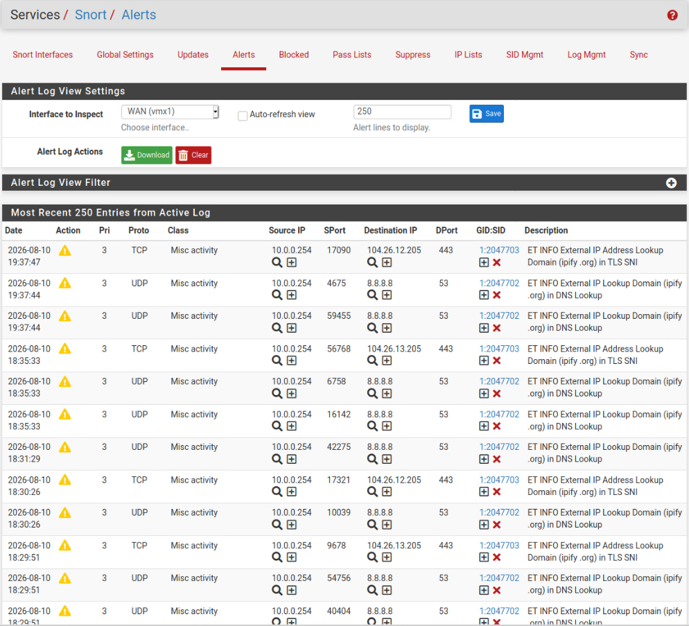
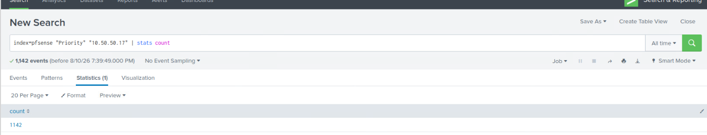
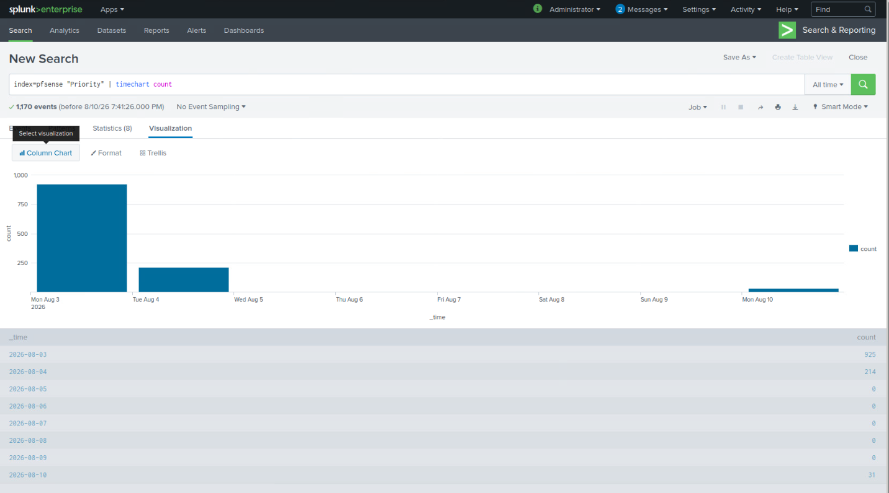
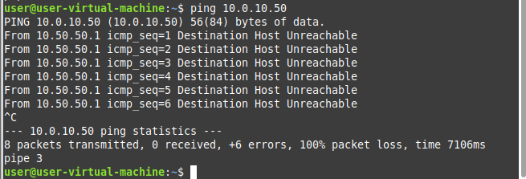
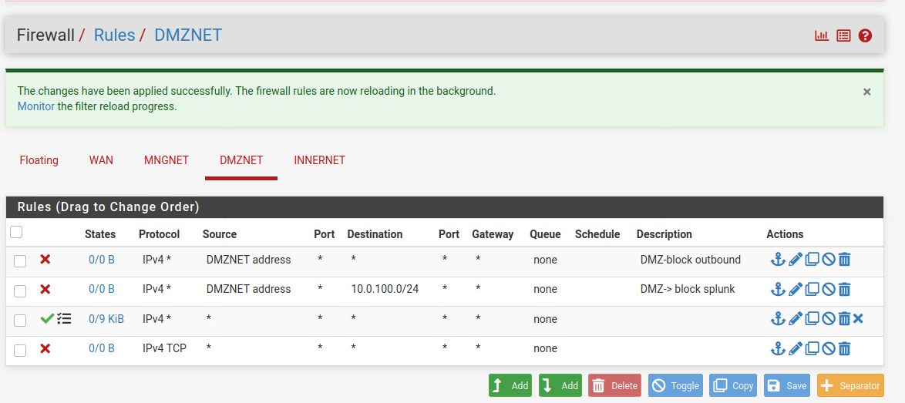
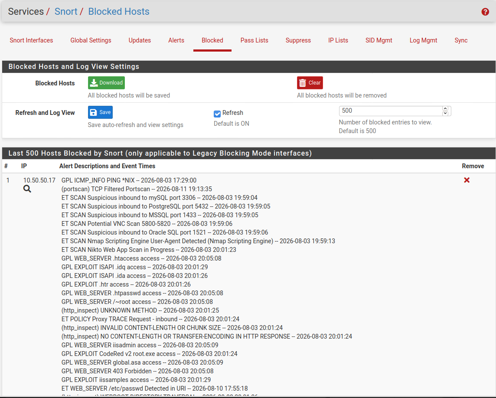

# Bee-box 탐지와 차단 검증

초기 Bee-box 환경에서 Snort 경보를 Splunk로 가져오고, 출발지와 시각으로 실습 요청을 확인한 뒤 pfSense와 Snort의 차단 정책을 단계별로 적용했습니다. WordPress와 MySQL을 추가한 최종 관제 회차는 [최종 보고서](../../../report/README.md)에서 다룹니다.

## Splunk 분석 준비

pfSense에서 전송한 syslog를 `pfsense` 인덱스로 받았습니다. Snort 경보에 필요한 출발지·목적지·목적지 포트와 시그니처를 원본 메시지에서 추출했습니다. 처음에는 필드가 자동으로 잡히지 않아, 필드 추출 결과와 이벤트 시각부터 확인했습니다.

## Snort 경보 확인

pfSense의 Snort Alerts에서 경보의 시각·출발지·목적지·시그니처를 확인한 뒤 Splunk에서 같은 이벤트를 찾았습니다.

## 출발지와 시간대 분석

Splunk에서 Snort 경보를 출발지별로 집계하고, 요청이 집중된 시간대와 시그니처의 분포를 대조했습니다. 이 회차의 경보는 **1,170건**이며, 주된 실습 단말의 출발지 `10.50.50.17`에서 **1,142건**이 기록됐습니다. 수치는 이 Bee-box 환경에서 센 Snort 경보입니다.

당시 Snort는 WAN에서 관찰했습니다. 경보의 목적지에는 Bee-box 내부 주소 대신 pfSense의 WAN 주소가 표시됐습니다. 목적지가 왜 다르게 보이는지 네트워크 배치와 비교했습니다.

## 방어 정책별 확인

| 적용한 정책 | 확보한 근거 |
| --- | --- |
| 출발지 기준 WAN 차단 | 같은 단말에서 연결을 다시 확인했습니다. 아래 캡처는 ICMP 요청이 닿지 않은 결과입니다. |
| DMZ 통신 제한 | DMZ에서 내부망으로 향하는 통신과 필요한 웹 서비스 범위를 방화벽 규칙에서 나눴습니다. |
| Snort 차단 모드 | Snort의 차단 호스트 목록에 실습 출발지가 올라온 것을 확인했습니다. |

[환경 구축](../README.md) · [최종 관제 보고서](../../../report/README.md)
