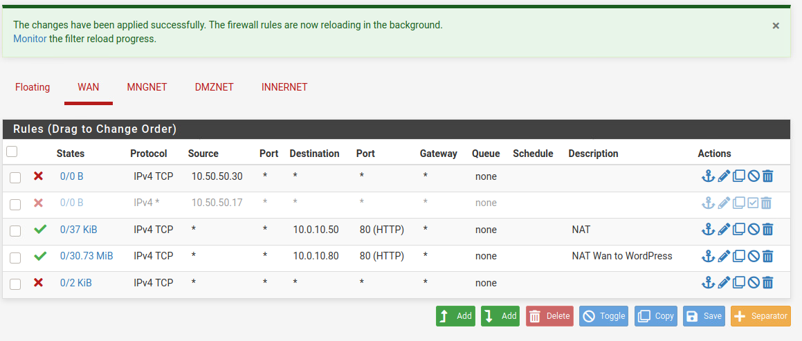

# 관제와 대응

관제 일지를 INC-001부터 INC-006까지 남겼습니다. 정찰, 인증 공격, SQL 인젝션 시도, 웹셸 실행, DB 정보 노출, 차단 검증을 각각 기록했습니다.

| 사건 | 판단과 조치 |
| --- | --- |
| INC-001 정찰 | WPScan 관련 경보와 웹 요청 증가를 확인하고 후속 활동을 모니터링했습니다. |
| INC-002 반복 인증 | 같은 출발지의 로그인 요청과 Splunk 경보를 대조했습니다. |
| INC-003 SQL 인젝션 시도 | Snort·WAF가 기록한 시도를 확인했습니다. 성공 여부는 웹 응답을 따로 확인했습니다. |
| INC-004 웹셸 실행 | 웹 요청과 실행 응답을 확인했습니다. 제거 완료 기록은 확보하지 못했습니다. |
| INC-005 DB 정보 노출 | 웹 응답에서 DB 정보 노출을 확인했습니다. 자격증명 교체와 감사 로그 보강을 후속 조치로 남겼습니다. |
| INC-006 차단 검증 | pfSense WAN 정책을 적용하고 동일 출발지의 HTTP 재접속 타임아웃을 확인했습니다. |

| 시각 | 실습 중 확인한 내용 |
| --- | --- |
| 18:49 | 스캐너 정찰을 관찰하고 후속 경보를 모니터링 |
| 19:16~19:20 | 반복 인증 요청 및 브루트포스 경보 확인 |
| 19:24~19:35 | SQL 인젝션 시도, 웹셸 실행, DB 정보 노출 근거 확인 |
| 19:40 이후 | pfSense 정책 적용 후 동일 출발지의 HTTP 재접속 실패 확인 |

초기 실습에서는 DMZ 통신 제한과 Snort 차단 모드도 별도로 확인했습니다. 최종 관제 회차의 HTTP 재접속 타임아웃은 pfSense 정책 조치의 검증 결과로 기록했습니다.

웹셸 제거, 자격증명 교체와 DB 감사 로그 수집은 후속 조치로 남겼습니다. 별도로 실패한 외부 전송 시도의 원인은 확인되지 않았습니다.

[최종 보고서](../../report/README.md)
