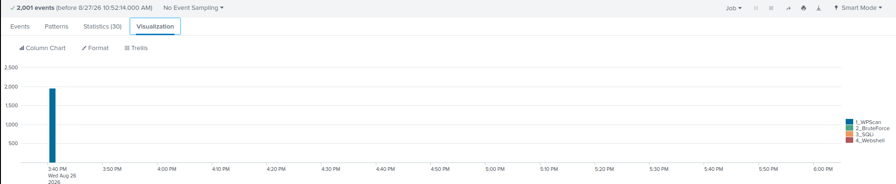

# 공격 시나리오

Bee-box에서 정찰, SQL 인젝션, XSS, 명령 주입, 인증 공격을 유형별로 관측했습니다. 이 기록으로 시그니처가 잡는 요청과 웹 애플리케이션 안에서만 드러나는 동작을 비교했습니다.

WordPress·MySQL 환경에서는 외부 정찰에서 데이터 접근까지 이어지는 흐름을 실습했습니다.

| 순서 | 실습에서 관찰한 단계 | 판단 근거 |
| --- | --- | --- |
| 1 | 정찰 | Snort 스캔 경보와 웹 요청 증가 |
| 2 | 초기 침투 시도 | SQL 인젝션 시도를 IPS·WAF에서 확인 |
| 3 | 인증 공격 | 동일 출발지의 반복 로그인 요청과 Splunk 경보 |
| 4 | 웹셸 접근과 실행 | 웹 요청 및 실행 응답에서 확인한 흔적 |
| 5 | 내부 정찰 | 웹 접근 기록과 실습 결과를 대조 |
| 6 | DB 접근 | 웹의 응답으로 정보 노출 확인. DB 전용 경보 없이 부분 탐지 |
| 7 | 외부 전송 시도 | 전송 실패 확인. 원인 미확정 |

이 표는 시나리오의 단계 순서입니다. 실제 관제 화면에서 경보가 뜬 시각은 [대응 기록](../response/README.md)에 있습니다.

[최종 보고서](../../report/README.md)
