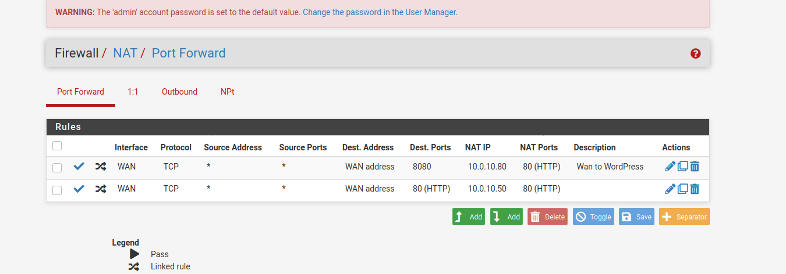

# 환경 구축

ESXi에서 실습망, 외부 경계망, DMZ, 내부망, 관리망을 나눴습니다. VyOS는 라우팅을 맡고, pfSense와 Snort는 망 경계에서 통신과 경보를 기록합니다.

[가상 스위치와 VM 배치](#가상-스위치와-vm-배치) · [WordPress·MySQL 구축](#wordpressmysql-환경-구축) · [Splunk 연동](#splunk-연동) · [초기 Bee-box 환경](#초기-bee-box-환경)

## 최종 실습망


복구한 ESXi에는 VM 9대가 등록돼 있습니다. VM 목록에서 `ubuntu`의 호스트 이름이 `splunk`로 표시됩니다. ESXi 관리용 `Management Network`는 `vSwitch0`에 있고, 실습 관리 단말의 `mng-net`은 별도 vSwitch에 연결됩니다.

### 가상 스위치와 VM 배치

실습용 포트 그룹 다섯 개를 같은 이름의 가상 스위치에 연결했습니다. 복구한 ESXi의 포트 그룹 화면에서 다섯 그룹 모두 VLAN ID 0으로 표시됩니다.

| 포트 그룹 | 연결된 장비 | 역할 |
| --- | --- | --- |
| `att-net` | VyOS, att-mint, Kali | 실습 단말이 연결된 외부 구간 |
| `rf-net` | VyOS, pfSense | 라우터에서 방화벽 WAN으로 이어지는 구간 |
| `dmz-net` | pfSense, Bee-box, WordPress | 웹 서비스 구간. WordPress에서 Apache와 ModSecurity 로그를 수집 |
| `inner-net` | pfSense, Splunk, MySQL | DB 서비스와 로그 수집 서버를 배치한 내부망 |
| `mng-net` | pfSense, mng-mint | 관제 화면을 확인하고 정상 접속을 비교한 관리망 |


## WordPress·MySQL 환경 구축

Bee-box에서 로그 수집과 차단 동작을 확인한 뒤, DMZ에 WordPress 서버를 추가하고 DB는 내부망의 별도 VM에 배치했습니다.

### 가상 머신과 포트 그룹

| VM | 가이드에 기록한 사양 | 연결 |
| --- | --- | --- |
| WordPress | Ubuntu 22.04, 1 vCPU, RAM 2 GB, 디스크 20 GB | `dmz-net`, `10.0.10.80/24`, 게이트웨이 `10.0.10.1` |
| MySQL | Ubuntu 22.04, 1 vCPU, RAM 1 GB, 디스크 15 GB | `inner-net`, `10.0.100.60/24`, 게이트웨이 `10.0.100.1` |
| Splunk | 내부망 수집 및 검색 서버 | `inner-net`, `10.0.100.50` |
| Kali | 외부망 접속을 확인한 실습 단말 | `att-net`, `10.50.50.30` |

VM에 가상 NIC를 추가한 뒤, ESXi 포트 그룹과 게스트 OS의 IP·게이트웨이 설정을 함께 확인했습니다. 외부망 단말에서 경계 쪽으로 연결이 이어지는지 확인할 때는 VyOS의 인터페이스와 라우팅 테이블, pfSense의 WAN 설정을 차례로 대조했습니다.


[VyOS 인터페이스와 라우팅 테이블](images/vyos-interfaces.png) · [pfSense WAN 연결 설정](images/pfsense-wan-interface.png)

### 웹과 DB 연동

1. DMZ VM에 Apache, PHP, WordPress를 설치했습니다.
2. 내부망 VM에 MySQL을 설치하고 WordPress용 DB와 별도 애플리케이션 계정을 만들었습니다. 실습용 데이터는 별도로 준비했습니다.
3. pfSense에서 WordPress가 MySQL의 TCP 3306에 접속하도록 허용하고, WordPress 서버에서 DB 연결을 확인했습니다.
4. 웹 서버에 ModSecurity와 OWASP CRS를 연동했습니다. 최종 관제 회차에서 WAF는 탐지 전용으로 두고, 방화벽 차단은 pfSense에서 적용했습니다.

### pfSense 정책

| 구간 | 적용한 정책 | 확인한 동작 |
| --- | --- | --- |
| WAN → DMZ | 외부 TCP 8080 요청을 WordPress 웹 서비스로 전달 | 외부 실습망에서 WordPress 접근 |
| DMZ → 내부망 | WordPress에서 MySQL TCP 3306으로 향하는 연결 허용 | WordPress의 DB 연결 |
| DMZ → 외부 | 패키지 설치용 임시 규칙 사용 후 제거 | 설치를 마친 뒤 불필요한 아웃바운드 제한 |



### Splunk 연동


| 서버 | 확인한 로그 | 전송 경로 | 수집 위치 |
| --- | --- | --- | --- |
| pfSense | 방화벽 filterlog, Snort 경보 | syslog UDP 514 | `pfsense` |
| WordPress | Apache 접근·오류, ModSecurity, 인증 | rsyslog TCP 9514 | `idx_web` |
| MySQL | 오류·슬로우 쿼리 | rsyslog TCP 9516 | `idx_db` |

수집 확인은 인덱스, 호스트, sourcetype 순으로 했습니다. 구축 시 보관한 인덱스·입력·파싱 설정을 보면 WAF에 별도 인덱스를 할당한 구성이 있습니다. 최종 관제에서 사용한 WAF 기록은 웹 서버가 전달한 `idx_web`에서 확인했습니다. MySQL도 최종 수집분에서는 `syslog`로 들어와, 전용 sourcetype을 전제로 만든 검색을 그대로 쓰면 기록이 빠질 수 있었습니다.

[인덱스 설정](splunk/indexes.conf) · [입력 설정](splunk/inputs.conf) · [파싱 설정](splunk/props.conf)

### 구축 뒤 확인한 항목

- 외부 실습망에서 WordPress 접속과 Apache 접근 로그
- WordPress에서 MySQL 연결 및 DB 로그 수집
- 관리 단말의 정상 접속과 웹·인증 로그
- ModSecurity 이벤트가 들어오는 실제 Splunk 인덱스

## 초기 Bee-box 환경


초기 Bee-box 환경에서 Snort 경보를 Splunk로 가져오고, 출발지와 시각으로 실습 요청을 확인한 뒤 pfSense와 Snort의 차단 정책을 단계별로 적용했습니다. WordPress와 MySQL을 추가한 최종 관제 회차는 [최종 보고서](../report/README.md)에서 다룹니다.

### Splunk 분석 준비

pfSense에서 전송한 syslog를 `pfsense` 인덱스로 받았습니다. Snort 경보에 필요한 출발지·목적지·목적지 포트와 시그니처를 원본 메시지에서 추출했습니다. 처음에는 필드가 자동으로 잡히지 않아, 필드 추출 결과와 이벤트 시각부터 확인했습니다.

원본 syslog를 바로 대조할 때 사용한 필드 추출 검색입니다. 시간대가 다른 센서를 비교하기 전에 Splunk가 표시하는 시각을 확인했습니다.

```spl
index=pfsense snort
| rex "(?P<src>\d+\.\d+\.\d+\.\d+):\d+\s+->\s+(?P<dest>\d+\.\d+\.\d+\.\d+):(?P<dest_port>\d+)"
| rex "snort\[\d+\]:\s+\[\S+\]\s+(?P<signature>[^\[]+)\s+\["
| table _time src dest dest_port signature
```

### Snort 경보 확인

pfSense의 Snort Alerts에서 경보의 시각·출발지·목적지·시그니처를 확인한 뒤 Splunk에서 같은 이벤트를 찾았습니다.


### 출발지와 시간대 분석

Splunk에서 Snort 경보를 출발지별로 집계하고, 요청이 집중된 시간대와 시그니처의 분포를 대조했습니다. 이 회차의 경보는 **1,170건**이며, 주된 실습 단말의 출발지 `10.50.50.17`에서 **1,142건**이 기록됐습니다. 수치는 이 Bee-box 환경에서 센 Snort 경보입니다.


당시 Snort는 WAN에서 관찰했습니다. 경보의 목적지에는 Bee-box 내부 주소 대신 pfSense의 WAN 주소가 표시됐습니다. 목적지가 왜 다르게 보이는지 네트워크 배치와 비교했습니다.

출발지, 시그니처, 시간대별 분포를 비교할 때 사용한 검색입니다.

```spl
index=pfsense | stats count by src | sort -count | head 10
```

```spl
index=pfsense 10.50.50.17 snort | top 10 signature
```

```spl
index=pfsense 10.50.50.17 snort | timechart span=5m count by signature
```

### 방어 정책별 확인

| 적용한 정책 | 확보한 근거 |
| --- | --- |
| 출발지 기준 WAN 차단 | 같은 단말에서 연결을 다시 확인했습니다. 아래 캡처는 ICMP 요청이 닿지 않은 결과입니다. |
| DMZ 통신 제한 | DMZ에서 내부망으로 향하는 통신과 필요한 웹 서비스 범위를 방화벽 규칙에서 나눴습니다. |
| Snort 차단 모드 | Snort의 차단 호스트 목록에 실습 출발지가 올라온 것을 확인했습니다. |

먼저 차단 전 WAN 정책과 실습 요청을 확인한 뒤 출발지 차단을 적용했습니다. Snort의 자동 차단은 출발지 차단 정책과 구분해 확인했습니다. DMZ 통신 제한은 마지막에 적용해 웹 서비스에 필요한 통신 범위를 확인했습니다.

[WAN 규칙 적용 전](bee-box/images/fw-1st-before.png) · [WAN 규칙 적용 후](bee-box/images/fw-1st-after.png)


[최종 보고서](../report/README.md)
