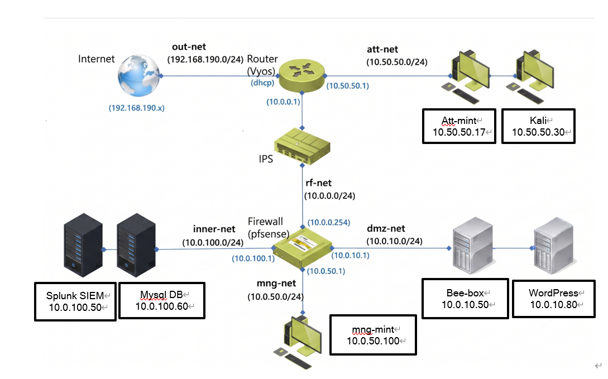
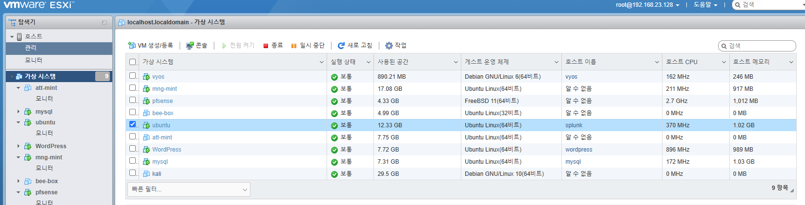
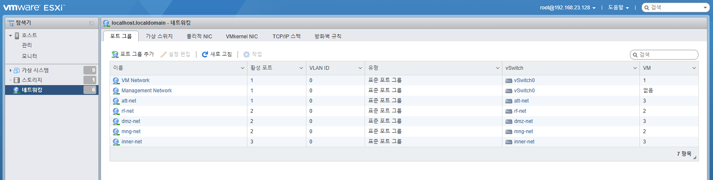
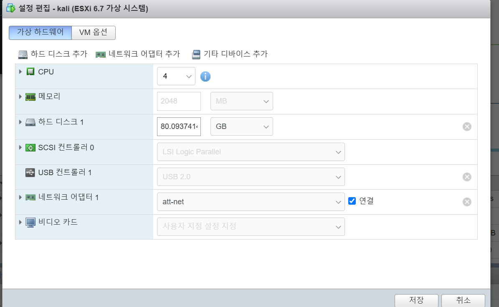
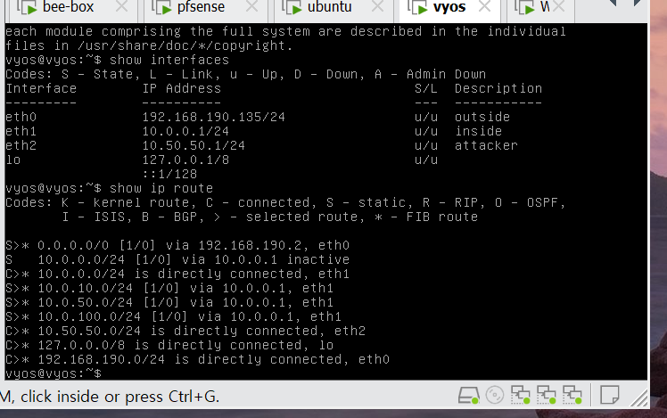
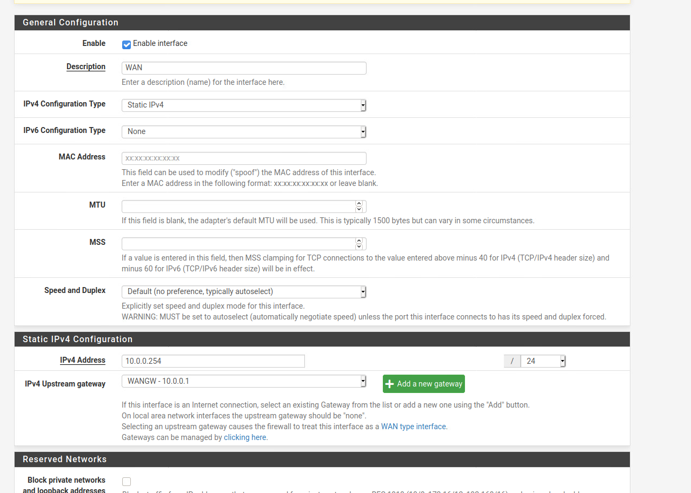
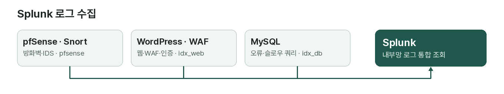

# 환경 구축

ESXi에서 실습망, 외부 경계망, DMZ, 내부망, 관리망을 나눴습니다. VyOS는 라우팅을 맡고, pfSense와 Snort는 망 경계에서 통신과 경보를 기록합니다.

## 최종 실습망



복구한 ESXi에는 VM 9대가 등록돼 있습니다. VM 목록에서 `ubuntu`의 호스트 이름이 `splunk`로 표시됩니다. ESXi 관리용 `Management Network`는 `vSwitch0`에 있고, 실습 관리 단말의 `mng-net`은 별도 vSwitch에 연결됩니다.

### 가상 스위치와 VM 배치

실습용 포트 그룹 다섯 개를 같은 이름의 가상 스위치에 연결했습니다. 복구한 ESXi의 포트 그룹 화면에서 다섯 그룹 모두 VLAN ID 0으로 표시됩니다.

| 포트 그룹 | 연결된 장비 | 역할 |
| --- | --- | --- |
| `att-net` | VyOS, att-mint, Kali | 실습 단말이 연결된 외부 구간 |
| `rf-net` | VyOS, pfSense | 라우터에서 방화벽 WAN으로 이어지는 구간 |
| `dmz-net` | pfSense, Bee-box, WordPress | 웹 서비스 구간. WordPress에서 Apache와 ModSecurity 로그를 수집 |
| `inner-net` | pfSense, Splunk, MySQL | DB 서비스와 로그 수집 서버를 배치한 내부망 |
| `mng-net` | pfSense, mng-mint | 관제 화면을 확인하고 정상 접속을 비교한 관리망 |





## WordPress·MySQL 환경 구축

Bee-box에서 로그 수집과 차단 동작을 확인한 뒤, DMZ에 WordPress 서버를 추가하고 DB는 내부망의 별도 VM에 배치했습니다.

### 가상 머신과 포트 그룹

| VM | 가이드에 기록한 사양 | 연결 |
| --- | --- | --- |
| WordPress | Ubuntu 22.04, 1 vCPU, RAM 2 GB, 디스크 20 GB | `dmz-net`, `10.0.10.80/24`, 게이트웨이 `10.0.10.1` |
| MySQL | Ubuntu 22.04, 1 vCPU, RAM 1 GB, 디스크 15 GB | `inner-net`, `10.0.100.60/24`, 게이트웨이 `10.0.100.1` |
| Splunk | 내부망 수집 및 검색 서버 | `inner-net`, `10.0.100.50` |
| Kali | 외부망 접속을 확인한 실습 단말 | `att-net`, `10.50.50.30` |

VM에 가상 NIC를 추가한 뒤, ESXi 포트 그룹과 게스트 OS의 IP·게이트웨이 설정을 함께 확인했습니다. 외부망 단말에서 경계 쪽으로 연결이 이어지는지 확인할 때는 VyOS의 인터페이스와 라우팅 테이블, pfSense의 WAN 설정을 차례로 대조했습니다.







### 웹과 DB 연동

1. DMZ VM에 Apache, PHP, WordPress를 설치했습니다.
2. 내부망 VM에 MySQL을 설치하고 WordPress용 DB와 별도 애플리케이션 계정을 만들었습니다. 실습용 데이터는 별도로 준비했습니다.
3. pfSense에서 WordPress가 MySQL의 TCP 3306에 접속하도록 허용하고, WordPress 서버에서 DB 연결을 확인했습니다.
4. 웹 서버에 ModSecurity와 OWASP CRS를 연동했습니다. 최종 관제 회차에서 WAF는 탐지 전용으로 두고, 방화벽 차단은 pfSense에서 적용했습니다.

### pfSense 정책

| 구간 | 적용한 정책 | 확인한 동작 |
| --- | --- | --- |
| WAN → DMZ | 외부 TCP 8080 요청을 WordPress 웹 서비스로 전달 | 외부 실습망에서 WordPress 접근 |
| DMZ → 내부망 | WordPress에서 MySQL TCP 3306으로 향하는 연결 허용 | WordPress의 DB 연결 |
| DMZ → 외부 | 패키지 설치용 임시 규칙 사용 후 제거 | 설치를 마친 뒤 불필요한 아웃바운드 제한 |


### Splunk 연동



| 서버 | 확인한 로그 | 전송 경로 | 수집 위치 |
| --- | --- | --- | --- |
| pfSense | 방화벽 filterlog, Snort 경보 | syslog UDP 514 | `pfsense` |
| WordPress | Apache 접근·오류, ModSecurity, 인증 | rsyslog TCP 9514 | `idx_web` |
| MySQL | 오류·슬로우 쿼리 | rsyslog TCP 9516 | `idx_db` |

수집 확인은 인덱스, 호스트, sourcetype 순으로 했습니다. 구축 시 보관한 인덱스·입력·파싱 설정을 보면 WAF에 별도 인덱스를 할당한 구성이 있습니다. 최종 관제에서 사용한 WAF 기록은 웹 서버가 전달한 `idx_web`에서 확인했습니다. MySQL도 최종 수집분에서는 `syslog`로 들어와, 전용 sourcetype을 전제로 만든 검색을 그대로 쓰면 기록이 빠질 수 있었습니다.

#### 인덱스 설정

```ini
# Splunk 인덱스 설정
# 배치: Splunk 서버(10.0.100.50)의
#   /opt/splunk/etc/system/local/indexes.conf
# 또는 Settings > Indexes 에서 GUI로 생성

# 웹 로그 인덱스 (Apache access/error, WordPress auth)
[idx_web]
coldPath = $SPLUNK_DB/idx_web/colddb
homePath = $SPLUNK_DB/idx_web/db
thawedPath = $SPLUNK_DB/idx_web/thaweddb
maxTotalDataSizeMB = 5120

# WAF 로그 인덱스 (ModSecurity)
[idx_waf]
coldPath = $SPLUNK_DB/idx_waf/colddb
homePath = $SPLUNK_DB/idx_waf/db
thawedPath = $SPLUNK_DB/idx_waf/thaweddb
maxTotalDataSizeMB = 2048

# DB 로그 인덱스 (MySQL slow query, error)
[idx_db]
coldPath = $SPLUNK_DB/idx_db/colddb
homePath = $SPLUNK_DB/idx_db/db
thawedPath = $SPLUNK_DB/idx_db/thaweddb
maxTotalDataSizeMB = 2048
```

#### 입력 설정

```ini
# Splunk Universal Forwarder 입력 설정
# 배치: /opt/splunkforwarder/etc/system/local/inputs.conf
#
# WordPress 서버 (10.0.10.80)용 설정
# MySQL 서버는 04-splunk-forwarder.sh에서 자동 설정

[default]
host = wordpress

# Apache Access Log
[monitor:///var/log/apache2/access.log]
disabled = false
index = idx_web
sourcetype = apache:access

# Apache Error Log
[monitor:///var/log/apache2/error.log]
disabled = false
index = idx_web
sourcetype = apache:error

# ModSecurity Audit Log
[monitor:///var/log/modsecurity/audit.log]
disabled = false
index = idx_waf
sourcetype = modsecurity

# WordPress Debug Log (인증 이벤트 포함)
[monitor:///var/www/html/wp-content/debug.log]
disabled = false
index = idx_web
sourcetype = wp:auth
```

#### 파싱 설정

```ini
# Splunk 필드 추출 설정
# 배치: Splunk 서버(10.0.100.50)의
#   /opt/splunk/etc/system/local/props.conf

# Apache Access Log 필드 추출
[apache:access]
TIME_FORMAT = %d/%b/%Y:%H:%M:%S %z
SHOULD_LINEMERGE = false
EXTRACT-apache = ^(?P<src_ip>\d+\.\d+\.\d+\.\d+)\s+-\s+(?P<user>\S+)\s+\[(?P<timestamp>[^\]]+)\]\s+"(?P<method>\w+)\s+(?P<uri>\S+)\s+\S+"\s+(?P<status>\d+)\s+(?P<bytes>\d+)\s+"(?P<referer>[^"]+)"\s+"(?P<user_agent>[^"]+)"

# Apache Error Log
[apache:error]
TIME_FORMAT = %a %b %d %H:%M:%S.%f %Y
SHOULD_LINEMERGE = false

# ModSecurity Audit Log
[modsecurity]
TIME_FORMAT = %d/%b/%Y:%H:%M:%S %z
SHOULD_LINEMERGE = true
BREAK_ONLY_BEFORE = ^--[a-f0-9]+-A--
MAX_TIMESTAMP_LOOKAHEAD = 40
EXTRACT-modsec_ruleid = id\s+"(?P<rule_id>\d+)"
EXTRACT-modsec_msg = msg\s+"(?P<rule_msg>[^"]+)"
EXTRACT-modsec_severity = severity\s+"(?P<severity>\w+)"
EXTRACT-modsec_uri = (?:GET|POST|PUT|DELETE)\s+(?P<request_uri>\S+)

# WordPress Auth Log
[wp:auth]
TIME_FORMAT = %Y-%m-%dT%H:%M:%S
SHOULD_LINEMERGE = false

# MySQL Slow Query Log
[mysql:slowquery]
TIME_FORMAT = %Y-%m-%dT%H:%M:%S.%6N%z
SHOULD_LINEMERGE = true
BREAK_ONLY_BEFORE = ^#\s+Time:
EXTRACT-mysql_query_time = Query_time:\s+(?P<query_time>[\d.]+)
EXTRACT-mysql_user = User@Host:\s+(?P<db_user>\S+)\[

# MySQL Error Log
[mysql:error]
TIME_FORMAT = %Y-%m-%dT%H:%M:%S.%6N%z
SHOULD_LINEMERGE = false
```

### 구축 뒤 확인한 항목

- 외부 실습망에서 WordPress 접속과 Apache 접근 로그
- WordPress에서 MySQL 연결 및 DB 로그 수집
- 관리 단말의 정상 접속과 웹·인증 로그
- ModSecurity 이벤트가 들어오는 실제 Splunk 인덱스
