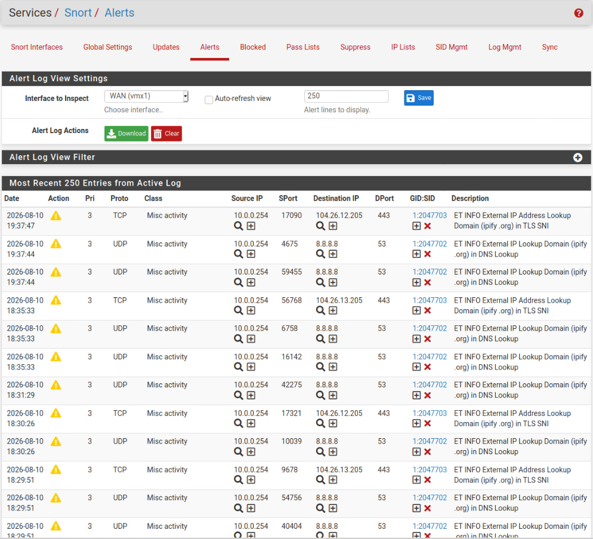
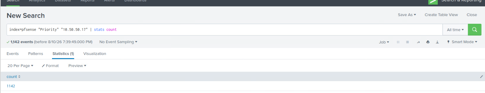
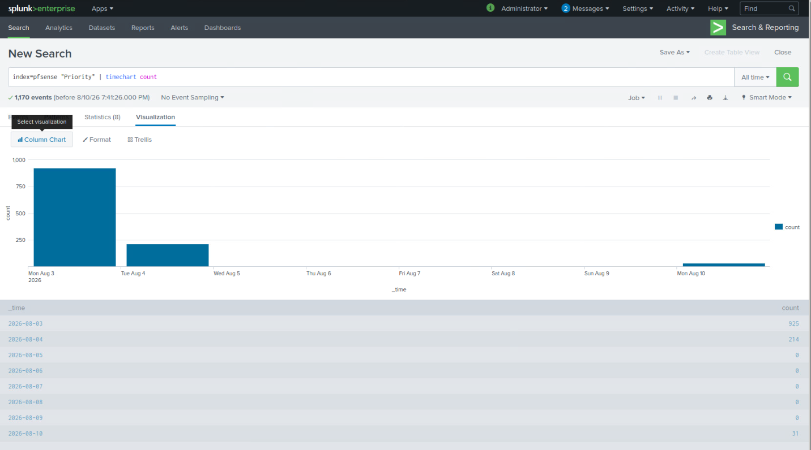
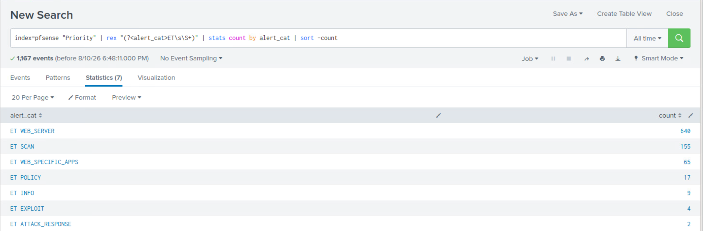
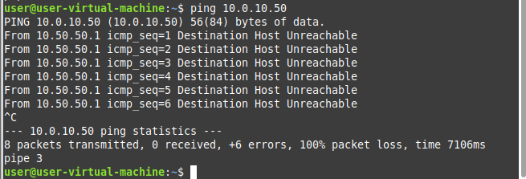
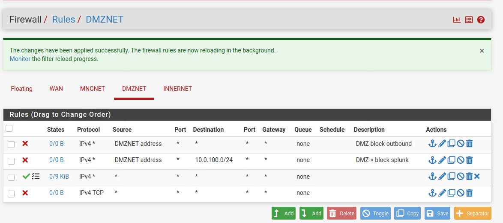
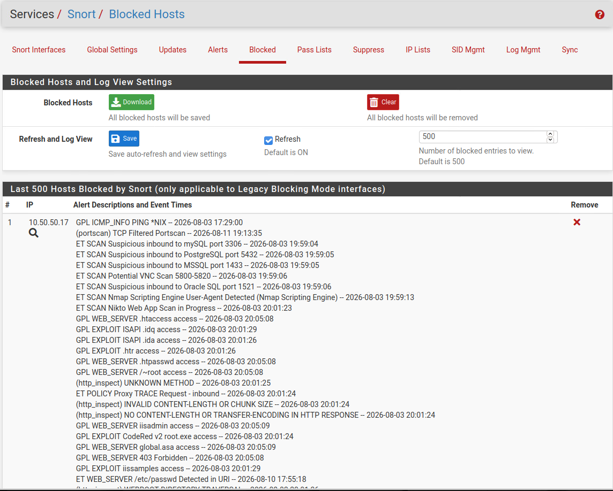

# Bee-box 탐지와 차단 검증

초기 Bee-box 환경에서 Snort 경보를 Splunk로 가져오고, 출발지와 시각으로 실습 요청을 확인한 뒤 pfSense와 Snort의 차단 정책을 단계별로 적용했습니다. WordPress와 MySQL을 추가한 최종 관제 회차는 [최종 보고서](../../report/README.md)에서 다룹니다.

## Splunk 분석 준비

pfSense에서 전송한 syslog를 `pfsense` 인덱스로 받았습니다. Snort 경보에 필요한 출발지·목적지·목적지 포트와 시그니처를 원본 메시지에서 추출했습니다. 처음에는 필드가 자동으로 잡히지 않아, 필드 추출 결과와 이벤트 시각부터 확인했습니다.

원본 syslog를 바로 대조할 때 사용한 필드 추출 검색입니다. 시간대가 다른 센서를 비교하기 전에 Splunk가 표시하는 시각을 확인했습니다.

```spl
index=pfsense snort
| rex "(?P<src>\d+\.\d+\.\d+\.\d+):\d+\s+->\s+(?P<dest>\d+\.\d+\.\d+\.\d+):(?P<dest_port>\d+)"
| rex "snort\[\d+\]:\s+\[\S+\]\s+(?P<signature>[^\[]+)\s+\["
| table _time src dest dest_port signature
```

## Snort 경보 확인

pfSense의 Snort Alerts에서 경보의 시각·출발지·목적지·시그니처를 확인한 뒤 Splunk에서 같은 이벤트를 찾았습니다.



## 출발지와 시간대 분석

Splunk에서 Snort 경보를 출발지별로 집계하고, 요청이 집중된 시간대와 시그니처의 분포를 대조했습니다. 이 회차의 경보는 **1,170건**이며, 주된 실습 단말의 출발지 `10.50.50.17`에서 **1,142건**이 기록됐습니다. 수치는 이 Bee-box 환경에서 센 Snort 경보입니다.







당시 Snort는 WAN에서 관찰했습니다. 경보의 목적지에는 Bee-box 내부 주소 대신 pfSense의 WAN 주소가 표시됐습니다. 목적지가 왜 다르게 보이는지 네트워크 배치와 비교했습니다.

출발지, 시그니처, 시간대별 분포를 비교할 때 사용한 검색입니다.

```spl
index=pfsense | stats count by src | sort -count | head 10
```

```spl
index=pfsense 10.50.50.17 snort | top 10 signature
```

```spl
index=pfsense 10.50.50.17 snort | timechart span=5m count by signature
```

## 방어 정책별 확인

| 적용한 정책 | 확보한 근거 |
| --- | --- |
| 출발지 기준 WAN 차단 | 같은 단말에서 연결을 다시 확인했습니다. 아래 캡처는 ICMP 요청이 닿지 않은 결과입니다. |
| DMZ 통신 제한 | DMZ에서 내부망으로 향하는 통신과 필요한 웹 서비스 범위를 방화벽 규칙에서 나눴습니다. |
| Snort 차단 모드 | Snort의 차단 호스트 목록에 실습 출발지가 올라온 것을 확인했습니다. |

먼저 차단 전 WAN 정책과 실습 요청을 확인한 뒤 출발지 차단을 적용했습니다. Snort의 자동 차단은 출발지 차단 정책과 구분해 확인했습니다. DMZ 통신 제한은 마지막에 적용해 웹 서비스에 필요한 통신 범위를 확인했습니다.

[WAN 규칙 적용 전](images/fw-1st-before.png) · [WAN 규칙 적용 후](images/fw-1st-after.png)







[환경 구축](../README.md) · [최종 관제 보고서](../../report/README.md)
