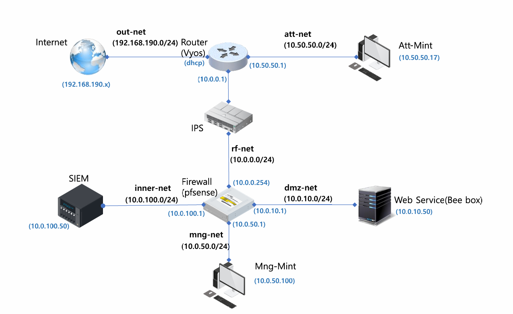

# 네트워크 구성

ESXi에서 실습망, 외부 경계망, DMZ, 내부망, 관리망을 나눴습니다. VyOS는 라우팅을 맡고, pfSense와 Snort는 망 경계에서 통신과 경보를 기록합니다.

~~~mermaid
flowchart LR
    A["실습망 · att-mint / Kali"] --> V["VyOS"]
    V --> F["경계망 · pfSense / Snort"]
    F --> W["DMZ · Bee-box / WordPress / ModSecurity"]
    F --> I["내부망 · MySQL / Splunk"]
    F --> M["관리망 · 관제 및 정상 요청"]
    W -. "웹·WAF·인증 로그" .-> I
    F -. "방화벽·IPS 로그" .-> I
~~~

위는 초기 Bee-box 구성도입니다. 후속 실습에는 DMZ의 WordPress·ModSecurity와 내부망의 MySQL을 추가했습니다.

| 구역 | 구성 | 관측 내용 |
| --- | --- | --- |
| 실습망 | att-mint, Kali | 실습에서 발생시킨 접근 |
| 경계망 | VyOS, pfSense, Snort | 라우팅, 방화벽 정책, 네트워크 경보 |
| DMZ | Bee-box, WordPress, Apache, ModSecurity | 웹 요청·오류, WAF 경보, 인증 시도 |
| 내부망 | MySQL, Splunk | DB 오류·느린 쿼리, 로그 통합 조회 |
| 관리망 | 관리 단말 | 정상 요청 비교와 관제 작업 |

pfSense syslog는 Splunk의 `pfsense`로, 웹·WAF·인증 로그는 `idx_web`로, MySQL 로그는 `idx_db`로 들어갔습니다. WAF용 `idx_waf`는 설정했으나 실제 관측은 `idx_web`에서 했습니다.

[최종 보고서](../report/README.md)
