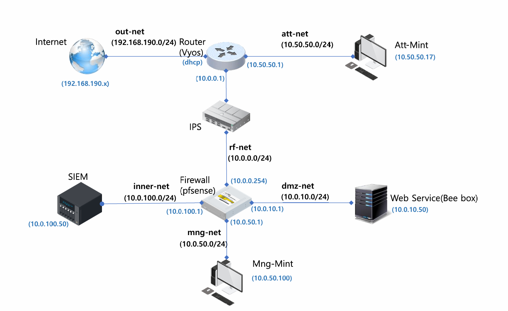
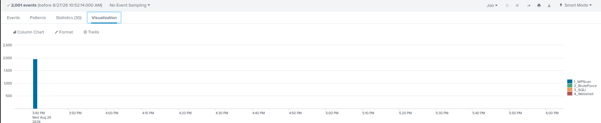
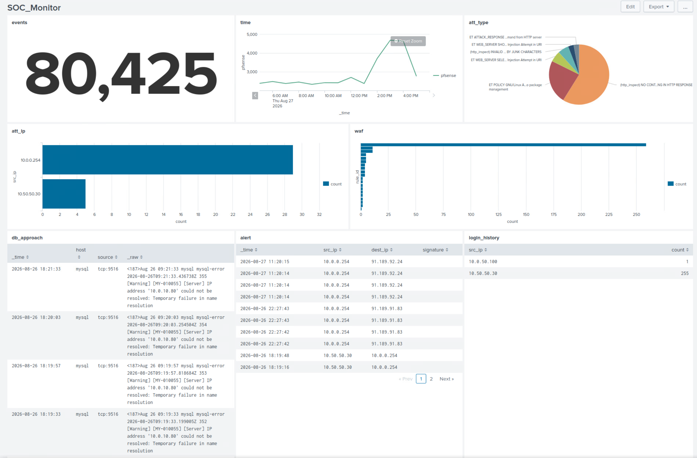
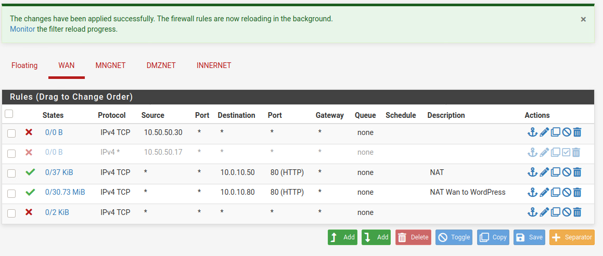
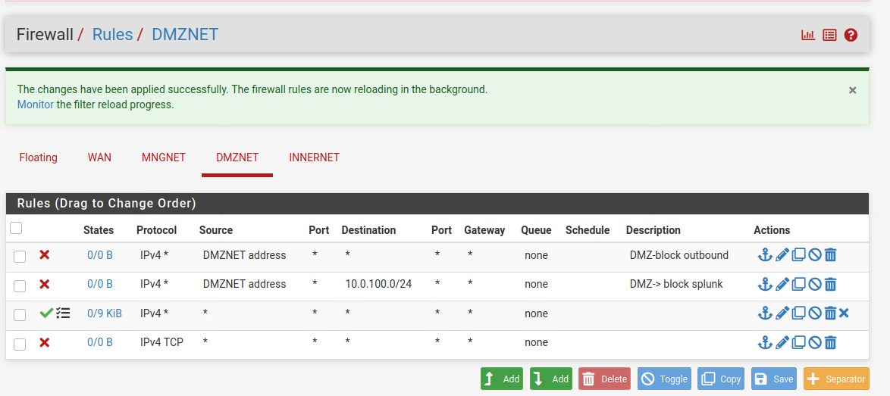
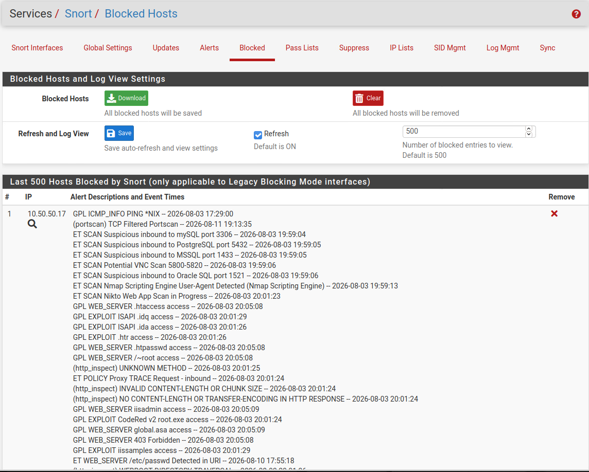

# SIEM 구축 및 탐지 대응 보고서

2026년 8월 실습 · 2026년 9월 정정 기록 반영 · 김병우 개인 프로젝트

## 프로젝트 개요

기업 환경을 본뜬 격리 가상망을 구성하고, 서로 다른 위치의 로그를 대조해 사고를 판단했습니다. 웹 서버에서 DB까지 접근한 정황을 추적한 뒤 pfSense 정책을 적용하고, 같은 출발지에서 다시 접근해 차단 결과를 확인했습니다.

| 구분 | 실습 결과 |
| --- | --- |
| 수집 | 방화벽·IPS, 웹·WAF·인증, DB에서 8개 로그 소스 구성 |
| 탐지 | 7단계 중 5단계 공격 시도 탐지, DB 접근 1단계 부분 탐지 |
| 경보 | Splunk 경보 5종 구성, 4종에서 총 7건 발생 확인 |
| 대응 | pfSense 정책 적용 후 동일 출발지 HTTP 재접속 타임아웃 확인 |

## 네트워크 구성

*초기 구성도. 후속 실습에서 DMZ의 WordPress·ModSecurity와 내부망의 MySQL을 추가했습니다.*

ESXi에서 실습망, 경계망, DMZ, 내부망, 관리망을 분리했습니다. VyOS가 라우팅을 맡고 pfSense·Snort가 경계에 위치합니다. DMZ에는 웹 서비스와 WAF를, 내부망에는 MySQL과 Splunk를 배치했습니다. 관리망에서는 정상 웹 요청과 경보를 비교했습니다.

<!-- pagebreak -->

## 로그 수집

| 구간 | 로그 | Splunk 인덱스 |
| --- | --- | --- |
| pfSense·Snort | 방화벽과 IPS 경보 | pfsense |
| 웹 서버 | Apache 접근·오류, ModSecurity, WordPress 인증 | idx_web |
| MySQL | 오류와 느린 쿼리 | idx_db |

WAF용 idx_waf를 만들었지만 실습에서는 idx_web에서 WAF 로그를 확인했습니다. 로그가 없는 위치는 경보의 존재 여부와 별도로 기록했습니다.

## 공격 시나리오

Bee-box에서 정찰, SQL 인젝션, XSS, 명령 주입, 인증 공격을 유형별로 관찰했습니다. 이후 WordPress·MySQL 구성을 추가하고 아래 흐름을 검증했습니다.

| 단계 | 관측한 행위 | 확인 결과 |
| --- | --- | --- |
| 정찰 | 웹 서비스와 노출 지점 확인 시도 | Snort 경보와 웹 요청 증가 |
| 초기 침투 | SQL 인젝션 시도 | IPS·WAF에 시도 기록 |
| 인증 공격 | 반복 로그인 요청 | Apache 기록과 Splunk 경보 확인 |
| 지속성 | 웹셸 접근·실행 | 웹 요청과 실행 응답에서 흔적 확인 |
| 내부 정찰 | 웹 서버 경유 내부 정보 확인 | 관련 웹 기록과 실습 결과 대조 |
| DB 접근 | 웹 서버 경유 DB 정보 조회 | 응답으로 정보 노출 확인. DB 측은 부분 탐지 |
| 외부 전송 | 외부 전송 시도 | 실패 확인. 원인 미확정 |

*시나리오 관련 이벤트의 시간대별 집계.*

<!-- pagebreak -->

## 로그 분석과 탐지

경보의 출발지와 시각을 웹 요청·WAF 기록과 대조했습니다. SQL 인젝션은 시도 경보를 확인했고, DB 노출은 웹의 실행 응답으로 범위를 확인했습니다. MySQL 오류·슬로우 로그는 정상 조회와 비정상 조회를 구분하기에 한계가 있었습니다.

*실습에서 사용한 SOC_Monitor. 이벤트 추이, 출발지, WAF, 인증 및 DB 기록을 모아서 확인했습니다.*

| 관측 항목 | 결과 |
| --- | --- |
| Snort | 커스텀 룰 9개 중 4개 SID에서 경보 기록 확인 |
| Splunk | 브루트포스, SQL 인젝션, 웹셸, WAF 급증 경보 발생 |
| 스캐너 | Snort에서 관찰. Splunk 저장 경보 발생 여부와 누락 원인은 미확정 |
| 정상 요청 | 관리 단말의 정상 접속 1건을 확인하고 반복 인증 요청과 구분 |

<!-- pagebreak -->

## 대응과 차단 검증

| 시각 | 관제 일지 |
| --- | --- |
| 18:49 | 스캐너 정찰을 관찰하고 후속 동작 모니터링 |
| 19:16~19:20 | 반복 인증 요청과 브루트포스 경보 확인 |
| 19:24~19:35 | SQL 인젝션 시도, 웹셸 실행, DB 정보 노출 근거 확인 |
| 19:40 이후 | pfSense WAN 정책 적용 후 동일 출발지 HTTP 재접속 타임아웃 확인 |

*최종 관제 회차에서 적용한 pfSense WAN 규칙.*

*별도 초기 실습에서 적용한 DMZ 통신 제한. Snort 차단 모드도 해당 실습에서 확인했습니다.*

사건 일지는 INC-001부터 INC-006까지 남겼습니다. 최종 회차에서 확인한 범위는 접근 차단까지이며, 웹셸 제거와 자격증명 교체는 후속 조치로 기록했습니다.

<!-- pagebreak -->

## 탐지 공백과 개선 권고

| 관측 결과 | 개선 방향 |
| --- | --- |
| 웹 응답으로 DB 노출을 확인했지만 전용 DB 경보는 없었음 | 쿼리 감사 로그를 모으고 정상 애플리케이션 조회의 기준을 마련 |
| 스캐너 저장 경보 발생 여부를 확인하지 못함 | 예약 검색 이력, 검색 범위, 임계값과 수집 지연을 대조 |
| WAF 기록이 웹 인덱스에 섞여 있음 | 수집 경로와 인덱스를 확인한 후 정상 요청 영향까지 평가 |
| 외부 전송 시도가 실패했으나 원인이 불명확함 | 방화벽 로그와 수신 측 상태를 함께 확보해 정책 효과를 판단 |

*초기 실습에서 확인한 Snort 차단 호스트 기록.*

실습 중 확인한 경보, 침해 근거, 정책 적용 결과를 각각 구분해 보고했습니다. 요청을 잡았다는 기록은 공격 시도를 보여주고, 침해 여부와 영향 범위는 응답·서비스 상태·추가 로그로 판단했습니다.

[네트워크 구성](../network/README.md) · [공격 시나리오](../scenario/README.md) · [로그 분석과 탐지](../detection/README.md) · [관제와 대응](../response/README.md)
