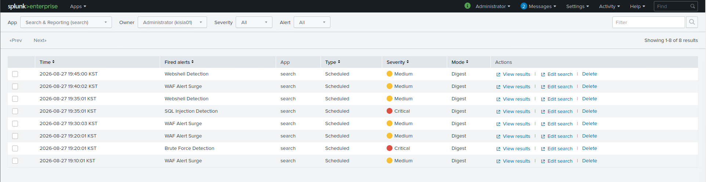
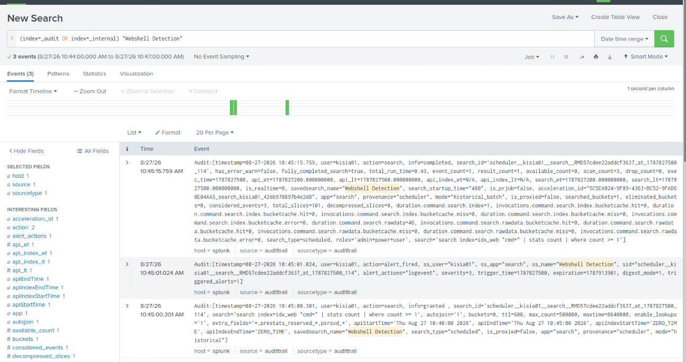
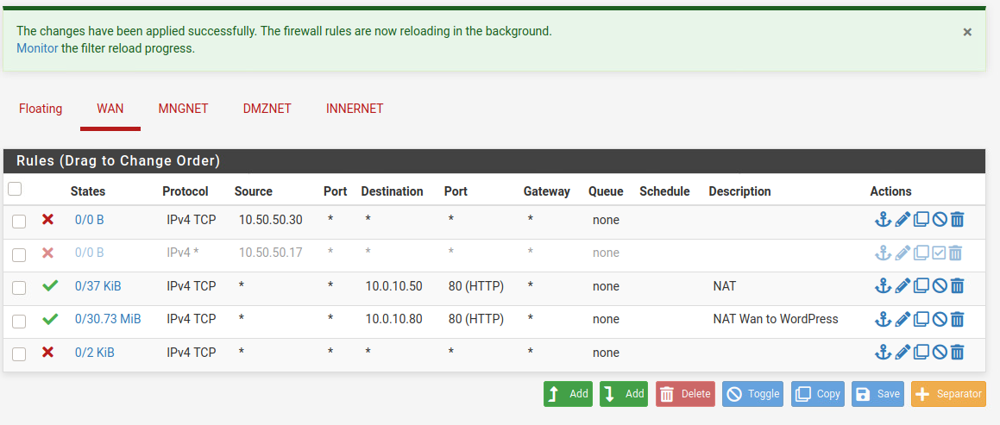

# 대응 내역

관제 일지를 INC-001부터 INC-006까지 남겼습니다. 정찰, 인증 공격, SQL 인젝션 시도, 웹셸 실행, DB 정보 노출, 차단 검증을 각각 기록했습니다.

## 대응 흐름

| 시각 | 실습 중 확인한 내용 |
| --- | --- |
| 18:49 | 스캐너 정찰을 관찰하고 후속 경보를 모니터링 |
| 19:16~19:20 | 반복 인증 요청 및 브루트포스 경보 확인 |
| 19:24~19:35 | SQL 인젝션 시도, 웹셸 실행, DB 정보 노출 근거 확인 |
| 19:40 이후 | pfSense 정책 적용 후 동일 출발지의 HTTP 재접속 실패 확인 |

## Splunk 경보

최종 관제 일지에는 4종 8건이 기록됐습니다. 정찰 흔적은 Snort와 웹 로그에서 확인했습니다.

| 시각 KST | Splunk 경보 |
| --- | --- |
| 19:10:01 | WAF Alert Surge |
| 19:20:01 | Brute Force Detection, WAF Alert Surge |
| 19:30:03 | WAF Alert Surge |
| 19:35:01 | SQL Injection Detection, Webshell Detection |
| 19:40:02 | WAF Alert Surge |
| 19:45:01 | Webshell Detection |

## 사건별 관제 일지

### INC-001 · 정찰

- **관측** · Snort 정찰 경보와 같은 출발지의 웹 접근이 늘었습니다.
- **판단** · 웹 요청의 User-Agent와 시각이 정찰 경보와 일치했습니다.
- **조치** · 같은 출발지에서 후속 경보가 발생하는지 지켜봤습니다.

### INC-002 · 반복 인증

- **관측** · 같은 출발지에서 로그인 요청이 몰렸고, 19:20에 Splunk 브루트포스 경보가 발생했습니다. 최종 관제에서 집계한 Apache 로그인 요청은 965건입니다.
- **판단** · 짧은 시간의 반복 요청과 출발지를 근거로 브루트포스 시도로 분류했습니다. 요청 집계에서 인증 성공과 실패를 따로 세지는 않았습니다.
- **조치** · 출발지를 기준으로 후속 경보와 웹 서버 기록을 추적했습니다.

### INC-003 · SQL 인젝션 시도

- **관측** · Snort의 SQL 인젝션 경보와 ModSecurity의 요청 경보를 확인했습니다.
- **판단** · 두 센서에서 요청 시도를 확인했습니다. 당시 웹 응답에서는 SQL 조회 성공이 확인되지 않았습니다.
- **조치** · 같은 출발지의 웹 요청과 응답을 계속 추적했습니다.

### INC-004 · 웹셸 접근과 실행

- **관측** · Snort 경보와 ModSecurity 요청 기록에서 출발지 IP와 포트가 일치했습니다. Splunk 감사 로그에는 19:45:01.024 KST에 저장 경보가 발생한 기록이 있습니다.
- **판단** · 센서 경보는 요청을 가리켰습니다. 서버에서 실제 동작이 있었는지는 실행 결과가 포함된 웹 응답을 확인해 판단했습니다.
- **조치** · 이어지는 DB 정보 접근 흔적을 찾고, 웹셸 제거를 후속 조치로 기록했습니다.

### INC-005 · DB 정보 노출

- **관측** · 웹 응답에 DB 계정 정보 일부가 나타났고, MySQL 오류·슬로우 로그가 수집됐습니다.
- **판단** · 웹 응답으로 정보 노출을 확인했습니다. DB 로그에서 해당 조회나 전체 영향 범위를 식별하는 데는 한계가 있었습니다.
- **후속 조치** · 자격증명 교체, MySQL 쿼리 감사 로그 추가, DMZ에서 내부 DB로 가는 통신 제한을 개선안으로 남겼습니다.

### INC-006 · WAN 차단과 검증

- **조치** · 해당 출발지의 TCP 트래픽을 막는 규칙을 pfSense WAN에 적용했습니다.
- **검증** · 같은 실습 출발지에서 웹 접속을 다시 시도했고 타임아웃을 확인했습니다.

## 차단 전후

초기 실습에서는 DMZ 통신 제한과 Snort 차단 모드도 별도로 확인했습니다. 최종 관제 회차의 HTTP 재접속 타임아웃은 pfSense 정책 조치의 검증 결과로 기록했습니다.

웹셸 제거, 자격증명 교체와 DB 감사 로그 수집은 후속 조치로 남겼습니다. 별도로 실패한 외부 전송 시도의 원인은 확인되지 않았습니다.
