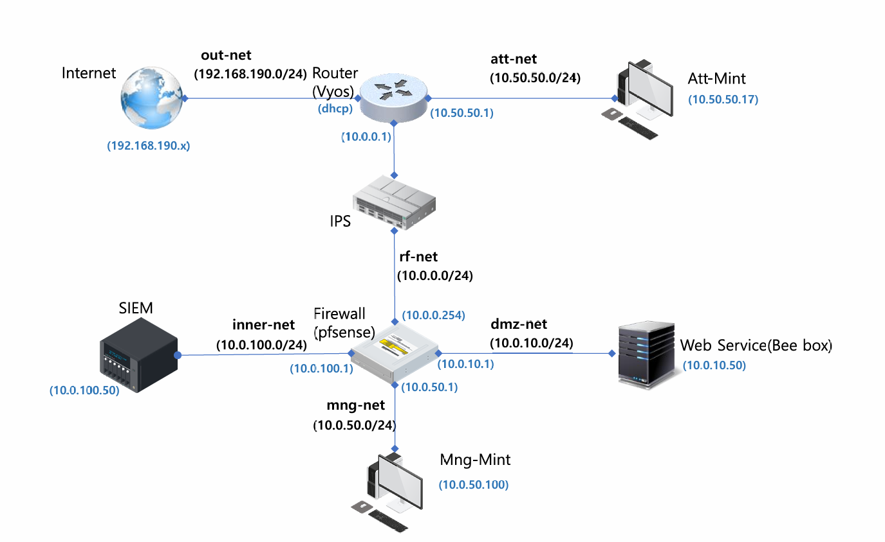
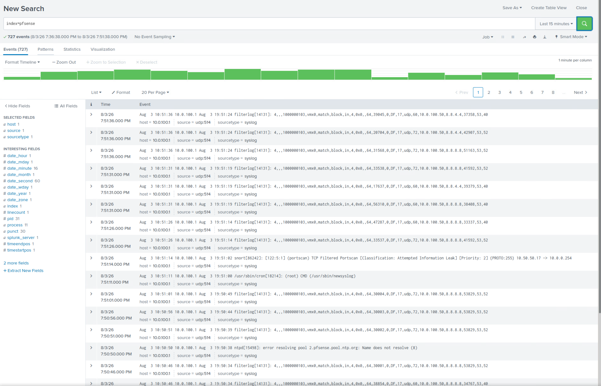
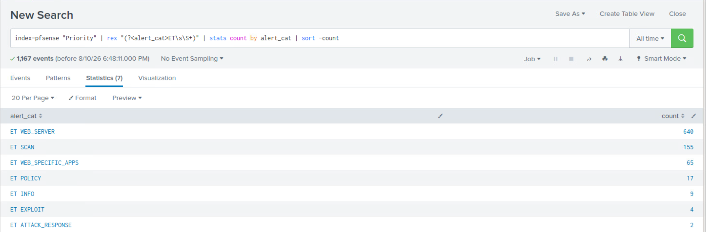
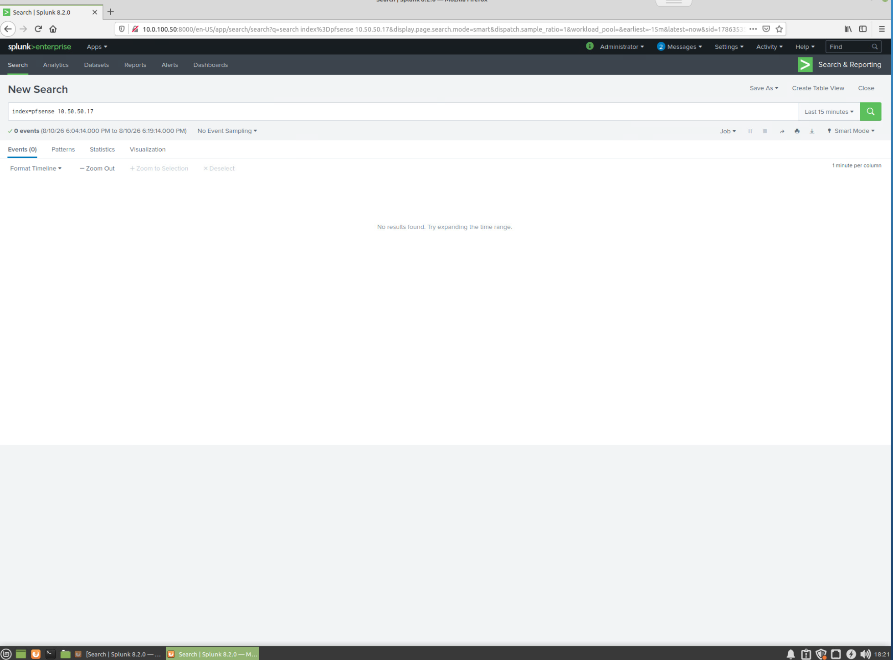
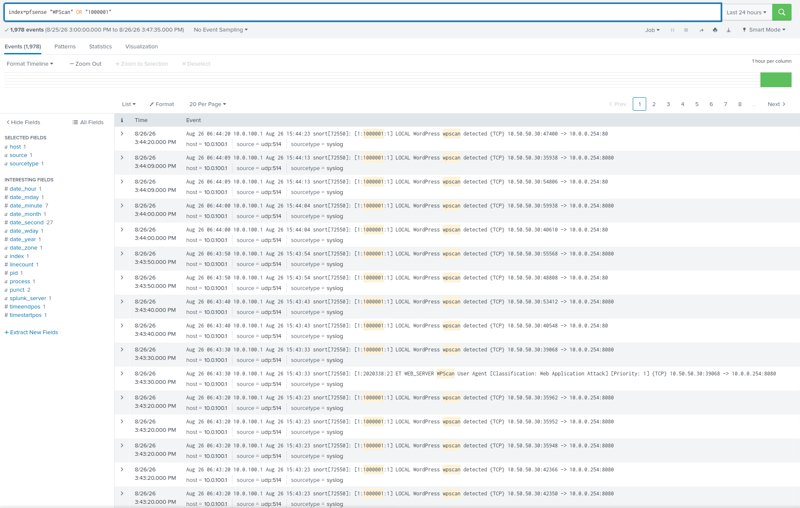
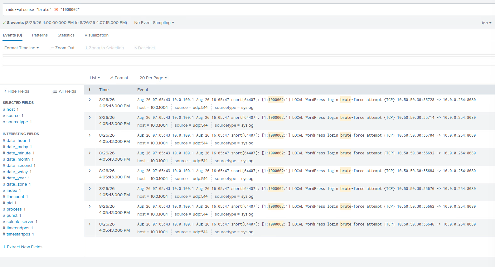
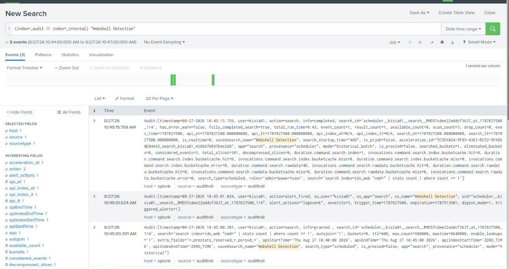
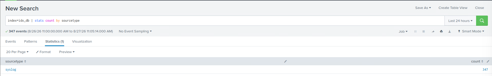

# 해킹 시나리오

Bee-box에서 웹 공격 유형별로 요청과 응답을 비교했습니다. WordPress와 MySQL을 추가한 뒤에는 외부 정찰부터 DB 접근과 외부 전송 시도까지 이어지는 시나리오를 실습했습니다.

## Bee-box 실습

### 1. 정찰

외부 실습망에서 접근 가능한 포트부터 확인했습니다. 서비스 버전을 비교하고 웹 서버의 설정과 노출된 경로를 조사했습니다. 포트 검색, 버전 확인, 웹 점검, 경로 확인을 따로 실행해 각 단계에서 발생한 요청과 Snort 경보를 구분했습니다.

### 2. SQL 인젝션

같은 입력 지점을 대상으로 수동 실습과 도구를 사용한 반복 요청을 각각 진행했습니다. Snort는 수동 실습에서 4건, 반복 요청 실습에서 211건을 기록했습니다. 두 실습의 요청량이 달라 경보 수는 실습 방식별로 기록했습니다.

### 3. 반사형 XSS와 저장형 XSS

반사형에서는 입력이 요청 URI에 나타나고 응답에 곧바로 반영되는 흐름을 살폈습니다. 이때 관련 Snort 경보가 3건 발생했습니다.

저장형에서는 입력을 저장한 요청과 이후 저장된 내용이 페이지에 표시된 응답을 따로 확인했습니다. 이 흐름을 기록한 시간대에 관련 Snort 경보는 없었습니다.

### 4. OS 명령 주입과 경로 탐색

명령 주입은 웹 요청과 서버 응답을 분리해 비교했습니다. 요청에서 관련 경보를 찾지 못했고 응답 방향에서 1건을 확인했습니다. 경로 탐색은 요청과 응답 방향에서 각각 1건씩 경보가 발생했습니다.

### 5. 반복 로그인

같은 출발지의 로그인 요청을 짧은 시간에 반복했습니다. Bee-box 실습에서는 관련 Snort 경보가 발생하지 않았습니다. 확장 환경에서는 웹 로그에서 출발지별 요청 빈도를 비교하고 반복 요청을 Splunk 경보로 확인했습니다.

## WordPress·MySQL 실습

외부 실습 단말에서 DMZ의 WordPress와 내부망 MySQL에 관련된 동작을 단계별로 확인했습니다. 시나리오 검증 기록과 최종 관제 회차의 건수는 따로 표시했습니다.

### 1. 외부 정찰 · T1595

먼저 포트와 서비스를 조사하고, 웹 서버 응답에서 WordPress 관련 버전 단서와 공개된 리소스를 확인했습니다. 리다이렉트 뒤에 보이는 Apache·PHP 헤더에는 초기 Bee-box 쪽 정보가 섞여 있어 대상 서버를 구분했습니다. Snort 룰별 검증에서는 정찰 시그니처를 확인했습니다.

### 2. 공개 웹 서비스에 SQL 인젝션 시도 · T1190

WordPress 검색 입력에서 SQL 인젝션 시도를 진행했습니다. 실습 중 사용한 입력에서는 DB 조회 성공을 확인하지 못했습니다. 같은 구간에 Snort와 ModSecurity가 기록한 경보는 확인했습니다. 룰별 검증 기록에는 Snort 커스텀 경보 3건과 ET 경보 18건이 남았습니다.

### 3. 반복 로그인 · T1110

같은 출발지에서 WordPress 로그인 요청을 반복하고 실패 응답과 인증 경보를 확인했습니다. 시나리오 검증 일지에는 한 차례 시험에서 13회 중 12회 실패와 1회 성공이 기록돼 있습니다.

탐지 검증에서는 Apache 로그인 페이지 접근 317건과 Snort 경보 8건을 확인했습니다. 최종 관제 회차에서는 Apache 로그인 요청 965건과 Splunk 브루트포스 경보를 확인했습니다.

### 4. 웹셸 접근과 실행 · T1505.003

웹셸 접근 요청과 서버가 돌려준 응답을 함께 확인했습니다. 요청에서 발생한 Snort 경보는 접근 시도를, 응답에 나온 웹 서버 실행 계정 정보는 실제 실행을 보여줬습니다. 로그인 시험과 웹셸 접근이 각각 관측됐으므로 웹셸 접근이 앞선 로그인 성공에 의존했다고 단정하지 않았습니다.

### 5. 내부 정찰 · T1046

웹 응답에서 서버의 호스트 정보와 DMZ 인터페이스 정보, DB 접속 설정이 반환된 것을 확인했습니다. 이 단계에서 확인한 범위는 웹 서버가 가진 내부 정보까지였습니다.

### 6. DB 정보 조회 · T1213

DMZ에서 내부망 MySQL에 접근한 뒤, 반환된 응답으로 스키마와 사용자 레코드 일부가 노출된 범위를 확인했습니다. 실습용 고객 테이블은 비어 있었습니다. MySQL 오류·슬로우 로그에는 접근 정황만 남아, 어느 레코드가 응답에 포함됐는지는 웹 응답으로 확인했습니다.

### 7. 외부 전송 시도 · T1041

DB 접근 뒤 DMZ 서버에서 외부 실습망으로 전송을 시도했습니다. 연결이 거부됐고 외부에서 수신한 데이터는 없었습니다. 이 시도의 결과는 최종 관제에서 별도로 수행한 pfSense WAN 차단 검증과 구분했습니다.
